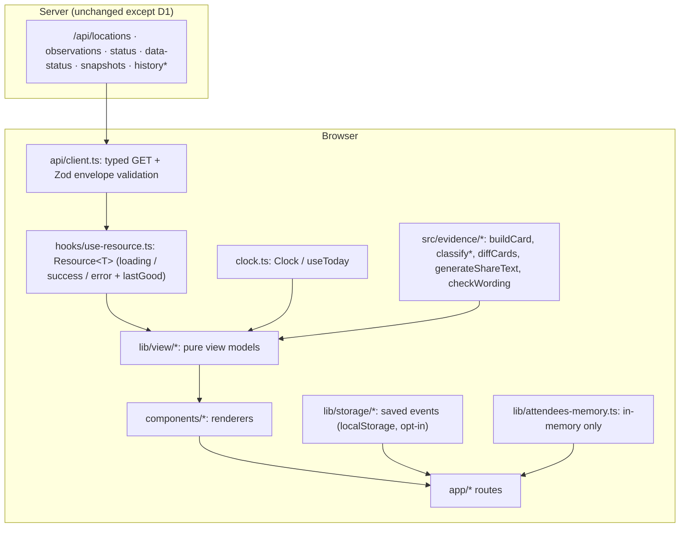
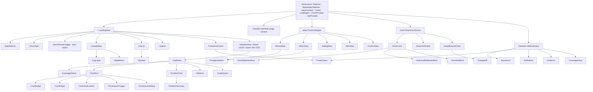

# Interactive Surveillance UI — Design

**Spec:** interactive-surveillance-ui (requirement prefix `UI-`; `UI-N` = Requirement N in `requirements.md`, `UI-N.M` = its criterion M)
**References:** `docs/BUILD_PLAN.md` v2.2 (§4, §5, §5A, §7, §8), `docs/MILESTONE_3_KIRO_PROMPT.md`, `design/{Main,Planner,OmenCard,States,Mobile,Tokens}.dc.html`, all files in `.kiro/steering/`, and the code that exists today in `src/app/api/`, `src/evidence/`, `src/server/` (there is no `src/components/` yet).

---

## Overview

Milestone 3 turns the existing read-only APIs and the pure evidence engine into five routes (`/`, `/city/[locationId]`, `/plan`, `/card`, `/methods`) and a small design system. The UI is a thin, honest presentation layer:

- **It never computes a classification.** Level, signal level and trend are rendered from `StatusObservation.activityIndex`, `signalLevel` and `trend` exactly as the API returns them. Freshness, timing, coverage, cards, share text and diffs come from `src/evidence/` (`classifyFreshness`, `classifyTiming`, `resolveCoverage`, `buildCard`, `generateShareText`, `diffCards`, `checkWording`, `formatDisplayDate`, `calendarDayDiff`, `toTorontoDateString`).
- **All view logic that can be wrong is a pure function** in `src/lib/view/` (no React, no I/O, no `new Date()`), so it is property-tested in the existing Vitest + fast-check setup. React components are thin renderers of those view models.
- **Unknown is a first-class state.** `unknown` has its own hatched visual, its own wording, and its own fog treatment. No code path maps missing data to `low`, `not_detected`, green, or "no fog".
- **Privacy by construction.** The API client's parameter types only admit public parameters (`locationId`, `pathogen`, `from`, `to`, `search`). Attendee categories live in an in-memory store whose only readers are the Planner confirm step and the on-screen Omen Card.
- **No runtime dependencies are added.** The map is precomputed SVG path data, the chart is hand-written SVG, state is React + URL, tests of components use `react-dom/server`. Only dev dependencies are added (Playwright, axe, and two build-time geometry tools).

### Key design decisions

| # | Decision | Rationale |
|---|---|---|
| K1 | Pure view-model layer (`src/lib/view/*`) between API data and components | Makes UI-17 property tests possible without a DOM; keeps components trivial |
| K2 | City page statements are produced by calling `buildCard` with `eventDate = today` and reading its `NearStatement[]` | Reuses freshness, coverage, regional labelling and rule IDs instead of duplicating them |
| K3 | Landing page fetches **all** latest observations once (`/api/observations`, 335 rows) and switches virus with a client-side selector | Satisfies UI-2.4 (single render) by construction |
| K4 | Drawer / bottom sheet is controlled by `?city=` on `/`; `/city/[locationId]` is the same `CityDetail` as a full page | Deep-linkable, no parallel/intercepting-route complexity |
| K5 | Single injectable clock (`src/lib/clock.ts`) is the only place `new Date()` is called in UI code | UI-14.8; a static test enforces it |
| K6 | Attendee categories held in a module-level in-memory store, not URL / storage / cookies | UI-8.7, UI-15; survives client-side navigation `/plan → /card`, is lost on reload (stated to the user) |
| K7 | Fonts via `next/font/local` with committed OFL `.woff2` files | Same `next/font` pipeline as UI-1.2, but no build-time dependency on Google's servers and no third-party request at runtime |
| K8 | No Tailwind; CSS variables + CSS Modules | The milestone prompt says Tailwind is optional; fewer moving parts; tokens are already CSS custom properties |

---

## Source conflicts, gaps and decisions

These are the places where the comps, `BUILD_PLAN.md`, steering files, requirements and the real code disagree. **D1, D2 and C1–C24 are approved; P1 and P2 are fixed in scope (UI-18).**

### Approved decisions

| ID | Finding | Proposed resolution |
|---|---|---|
| **D1** | **No API serves measured history.** `/api/observations` reads only `trend-latest.json` (`StatusObservation[]`, latest week). `readHistory()` exists in `src/server/normalized-data.ts` but no route exposes it. `buildCard` (past / too-early cards) and the Timeline_Chart (UI-6) both need `MeasuredWeek[]`. `requirements.md` scope says "excludes API changes". | Add **one additive, read-only route** `GET /api/history?locationId&pathogen&from&to` returning `ApiEnvelope<MeasuredWeek[]>` (Zod-validated, 400/404 like its siblings; known location with no history file → 200 `[]`). No other API changes. If you refuse, UI-6 and the past / too-early card variants cannot be built honestly. |
| **D2** | **The Gazetteer has no coordinates** (`src/server/geo/cities.ts` holds slug, name, province, pruid only), yet UI-3.3 says markers use "coordinates in the Gazetteer". It is also server-only and `/api/locations` does not return coordinates. | Build-time script produces `src/data/geo/city-points.json` from Natural Earth populated places (public domain) plus a small hand-checked override table (each override carries a citation). Locations without a verified point get **no marker** and stay in the list. No coordinates are invented. |

### Pre-existing defects found (not caused by this spec; they affect what the UI can show)

| ID | Finding | Handling in this design |
|---|---|---|
| **P1 (FIX IN SCOPE, UI-18.3–18.5)** | `data/normalized/index.json` holds ~306 entries from `https://example.com/test.csv` written by tests (ING-13 isolated the snapshot dir but not the index). `/api/data-status` picks `validSnapshots[0]` by `fetchedAt`, and that is a test entry (`2026-10-31T23:37Z`, `example.com`), so `lastSuccessfulFetch` and `schemaVersion` are currently wrong. Real PHAC entries also show `rowCount: 0`. | Fixed: the index path in `src/server/ingest/snapshot-store.ts` becomes injectable (env `NORMALIZED_DIR`, default `data/normalized`); example.com entries are removed by re-running `npm run ingest` into a clean index; `rowCount` is set from the parsed file; a test asserts ingestion tests never touch `data/normalized/`. As defence in depth the UI still resolves the snapshot by `data-status.trendSnapshotId` against `/api/snapshots` and accepts only entries whose `sourceUrl` equals `TREND_SOURCE_URL`. |
| **P2 (FIX IN SCOPE, UI-18.6–18.7)** | `buildCard` historical statements use `history.find(epiWeek)`, i.e. the first matching year. For PAST events the card must use the row whose `epiYear` AND `epiWeek` match the event date; `epiWeek`-only first match stays acceptable only for the `histMin`/`histMax` band. `buildHistoricalContext` in `src/evidence/card.ts` is changed accordingly (needs `epiYear` from `dateToEpiWeek`); all 116 existing tests must stay green. Original analysis follows. | Verified on `toronto-fluA.json` (EpiWeek 52, years 2022–2025): `histMin`/`histMax` are identical across years, so the first match is safe for the band. No UI change. A property test over the real history files guards this assumption. |
| **P3** | Plan §7 says history files are "≈ few KB each"; `toronto-fluA.json` is 78 KB raw (199 weeks); all history is ~25 MB. | The timeline requests `from = latest − 52 weeks` by default (server-side filter), with "Show all history" opt-in. Never the full set. |

### Conflicts between comps, plan, steering and requirements

| ID | Conflict | Resolution |
|---|---|---|
| C1 | **Path:** plan §5A says `kiroween/design/`; the repo has `design/`. Steering `design-language.md` says `design/*.dc.html`. | `design/` is the source of truth. The plan reference is stale; fix the plan text in a docs follow-up. |
| C2 | **Map data:** plan §7 / L6 says StatCan boundaries (OGL) + d3-geo at runtime; milestone prompt says Natural Earth admin-1. | Prompt wins (it is newer and the requirements follow it): Natural Earth admin-1, public domain. Projection is done at build time, so no d3 at runtime. |
| C3 | **Styling:** steering `architecture.md` says Tailwind + shadcn/ui; prompt says Tailwind optional. | CSS variables + CSS Modules (K8). shadcn is not used. |
| C4 | **Chart library:** plan says Visx or Recharts. | Hand-written SVG: needs exact gap semantics, keyboard-focusable points and zero extra bundle. |
| C5 | **Type scale:** requirement UI-1.3 and §5A list 12/14/16/20/28/40; comps use 34, 42, 44, 46 px for headings and the Tokens comp even lists "46". | Implement the six-step scale. h1 = 40, card title = 40, drawer h2 = 28, mobile h1 = 28. Comp headings above 40 are treated as sketch values. |
| C6 | **Radius:** tokens give 6/12/20; comps use pill (999px) chips and 8/10/14 px panels. | Add `--radius-pill: 999px`; map comp 8/10/14 to 6/12/12/20 tokens. Not user-visible in a meaningful way. |
| C7 | **Not-detected fog:** comp draws no fog for Not detected; UI-3.4 requires density to increase `not_detected < low < moderate < high`; UI-3.5 and the prompt forbid "no fog" for unknown. | Not detected gets the faintest fog (not zero). Unknown gets a hatched halo and no teal fog. Distinguishable by hatch + glyph + word. |
| C8 | **Lantern colour:** `--lantern` is "focus, primary action, freshness only", yet the comp timeline marks "official PHAC level on file" with a lantern-coloured dot (UI-6.6 asks for a "lantern marker"). | The timeline marker is a fixed-colour diamond with a text label of the week's official level. Its colour never varies with level or freshness, so it encodes neither. |
| C9 | **Checklist copy:** comp paraphrases ("Consider a well-fitting mask", "Stay home if you're sick"); `copy/checklist.ts` is verbatim PHAC ("Wear a well-fitting respirator or mask.") and UI-14.6 mandates the module. | Use `PREVENTION_CHECKLIST` unchanged. Comp has 6 items; module has 6 items; ordering from the module. |
| C10 | **Comp text fails the Wording_Guard:** OmenCard comp says "'not detected' does not mean no infections"; `checkWording` bans "no infections". | Template: "Not detected is not a guarantee that nobody in the community is infected." Verified phrase set goes through Property 18. |
| C11 | **Attendee-tailored precautions:** comp shows "Infants may attend: PHAC lists very young infants among those at greater risk of serious complications." No such sourced copy exists in `checklist.ts`. | Not built. The card shows the chosen categories as chips (on screen only) and the standard checklist. Tailored lines may be added later only if added to `copy/checklist.ts` with a PHAC source and review date. |
| C12 | **"Next PHAC update expected Wed Nov 4"** (OmenCard comp) is not derivable from any data we hold. | Omitted. We state only "No newer snapshot is available" (UI-10.9). |
| C13 | **Setting:** comp has two fields (Indoor + "Gathering type: Family dinner"), `EventCard.setting` is one string, UI-8.3 says fixed list. | Two fixed lists (venue, kind) whose ids are in the URL; `setting` string = `"{Venue} · {Kind}"` from the fixed labels. Card title uses the kind label as in the comp. |
| C14 | **Share preview:** comp shows hand-written share text; UI-9.10 requires copied text == shown text. | Preview renders `generateShareText(card)` verbatim (monospace, preserving line breaks). |
| C15 | **"Download image"** (comp) is F12 (P1). | Not built. |
| C16 | **Replay card #4** in `States.dc.html` is F11, out of scope. | Not built. `--replay` token is defined for later. |
| C17 | **Too-early card in comp shows four years of w_avg bars.** `buildCard` too-early statements carry only `histMin`/`histMax` for the EpiWeek by design (no measured values for the event's week). | Render the min–max band per virus only, labelled "past observations, not a prediction". Multi-year bars are not built. |
| C18 | **Comp "Why does it say this?" shows raw CSV row and raw `latestTrend`.** `StatusObservation` carries neither raw row nor the raw `latestTrend` string. | Provenance shows snapshot ID, field name, grouping, location ID, rule ID, interpretation method and source URL. Trend is shown as PHAC's 5-week trend (`Stable`), not the raw string. |
| C19 | **Comp hard-codes site names** ("2 active sites (Humber, Ashbridges Bay)") and sample cities (Metro Vancouver, Calgary). | Everything is derived from the API; site counts come from `grouping === "site"` rows sharing the city's `city` + `province`. No names or coverage hardcoded (scientific-integrity). |
| C20 | **Contrast:** `--level-high` `#E0664F` on `ink-700` is 4.36:1 (< 4.5); Omen Card dark-variant glyph `#9A6512` on parchment is 3.74:1; `--level-unknown` `#5A6178` on `ink-800` is 2.81:1. | These are non-text graphics (3:1 required) paired with a word, except `#5A6178`. Badge background is `ink-800` (5.08:1 for the high glyph); the hatch stroke is `#8C93A8` (as in the comps, 6.18:1), `#5A6178` is used only for the extinguished lantern outline on `ink-700` and the hatch gap fill. The contrast table test (Testing Strategy) uses 4.5:1 for text and 3:1 for graphics and is the gate. |
| C21 | **No comps** exist for `/methods`, standalone `/city/[id]`, mobile planner/card, loading skeletons or the mobile drawer. | Composed from the existing tokens and components; reviewed in the browser against the Tokens comp. Methods page reuses the card and `States` section styles. |
| C22 | **Nav labels:** comp nav is "Map / Plan a gathering / Behind the mask" and "Behind the mask" links to `States.dc.html` (the honesty-states board), while plan §4E defines Behind the Mask as the methods page. | Nav labels as in the comp; "Behind the mask" → `/methods`. The honesty states are component states, not a page. |
| C23 | **"Show discontinued sites"** (UI-3.8) vs. steering "never hardcode discontinued". Plan §4 lists named cities. | Derived: a row is "discontinued" for the selected virus when its observation is `na2_not_sampling` or its `trend` is `unknown` (PHAC "No Recent Data"). Row labels say "stopped sampling or no recent data (NA2)" / "no recent data"; we never write "discontinued by PHAC" because that is a PHAC notice we do not ingest. |
| C24 | **Comp label "Our last check"** vs requirement "last successful ingest". Conditional-GET 304 runs are not recorded in the index, so "last check" cannot be known. | Label is "Our last successful ingest" and the value is the matched snapshot's `fetchedAt`. |

---

## Architecture

### Layers and data flow



`*` = new route proposed in D1. Nothing flows from `Mem` to `ApiClient`: the client has no parameter type that can carry it.

### Directory layout (new files)

```
src/
  app/
    layout.tsx                 # fonts, skip link, header/nav, footer landmark, live region, providers
    globals.css                # tokens (CSS variables), reset, focus ring, reduced-motion rules
    page.tsx                   # "/"   (server shell: h1, limitation line; client island below)
    city/[locationId]/page.tsx # "/city/[locationId]"
    plan/page.tsx              # "/plan"
    card/page.tsx              # "/card"
    methods/page.tsx           # "/methods"
    not-found.tsx
    api/history/route.ts       # D1 (only server addition)
    fonts/                     # committed OFL .woff2 + LICENSE files
  components/
    design-system/             # LevelBadge, TrendGlyph, FreshnessLantern, ThreeClocks, GuideQuote,
                               # Button, Chip, Notice, Skeleton, VisuallyHidden, LiveRegion
    shell/                     # SiteHeader, SiteNav, SkipLink, Footer
    landing/                   # LandingView, VirusChips, CanadaMap, FogLayer, MapMarker, CityList,
                               # CityRow, Legend, StaleBanner, FreshnessFooter, DetailSurface
    city/                      # CityDetail, VirusRow, CoverageNotice, TimelineChart, TimelineSummary,
                               # SitesList, ProvenanceDialog, ProvenanceTrigger
    planner/                   # PlannerStepper, WhereStep, WhenStep, SettingStep, WhoStep, ConfirmStep, TimingExplainer
    card/                      # OmenCard, VirusStatementRow, HistoricalStatementRow, ShareTextPanel,
                               # SavedEventsPanel, ChangeDiff, ChecklistBlock
    methods/                   # SourceList, Definitions, LimitsList, CoverageFacts
  lib/
    clock.ts
    api/{client.ts, schemas.ts, urls.ts, errors.ts}
    hooks/{use-resource.ts, use-media-query.ts, use-hydrated.ts, use-url-state.ts}
    view/{level.ts, trend.ts, freshness.ts, landing-rows.ts, fog.ts, city-view.ts, timeline.ts,
          provenance.ts, planner.ts, card-view.ts, diff-view.ts, coverage-facts.ts, three-clocks.ts}
    storage/{saved-events.ts, saved-event-schema.ts, storage-port.ts}
    attendees-memory.ts
    url-state.ts               # landing + card + city URL schemas (Zod) and builders
  ui-copy/                     # fixed template modules (all user-facing health sentences)
    {levels.ts, unknown-reasons.ts, freshness.ts, coverage.ts, timing.ts, card.ts, methods.ts,
     guide.ts, planner-options.ts, states.ts, index.ts}
  data/geo/
    canada-provinces.geojson   # simplified Natural Earth admin-1 (WGS84)
    canada-provinces.projected.json
    city-points.json
    SOURCE.md
scripts/build-geometry.ts      # build-time projection + simplification (dev-only deps)
tests/
  ui/…  (see Testing Strategy)
e2e/…   (Playwright)
```

### Route and data-loading strategy

Pages are Next.js server components that render only static shell content (heading, limitation line, landmarks) so the `h1` and LCP text are in the first HTML. All data comes from the read API through one client island per route (UI-2.5, UI-16.4). No page imports from `src/server/`.

| Route | Server shell | Client requests (all `GET`, same origin) | Notes |
|---|---|---|---|
| `/` | `h1`, limitation sentence, `<Suspense>` | In parallel on mount: `/api/locations`, `/api/observations`, `/api/data-status`, `/api/snapshots`. Typed search → `/api/locations?search=q` (debounced 250 ms, list only). | `useSearchParams` requires the island inside `<Suspense>` (Next 15 build rule). State in URL: `?virus=&city=&view=&discontinued=`. |
| `/city/[locationId]` | `h1` placeholder replaced on load; `params` awaited (Next 15) | `/api/status?locationId=`; `/api/history?locationId=&pathogen=&from=` for the selected virus only (and for the province aggregate id when the user chooses it). | Invalid slug format or API 404 → not-found state (UI-5.11). |
| `/plan` | `h1`, intro | `/api/locations` on mount; `/api/status?locationId=` after a place is chosen (to show the "week of" the card will use). | Local reducer state; attendee categories to memory store only. |
| `/card` | `h1` shell | `/api/status?locationId=`; if timing ≠ `near`: `/api/history?locationId=&pathogen=` ×4 (`from` limited around the event EpiWeek not required; whole-file request is ~10 KB gzip each). | `buildCard` runs in the browser. For `?saved=<id>` the baseline comes from `localStorage`; the current card is rebuilt for the diff. |
| `/methods` | all static prose | `/api/data-status`, `/api/snapshots`, `/api/locations`, `/api/observations` (to derive coverage / discontinued counts). | Static copy renders without waiting; only clocks and facts show skeletons. |

**Response validation.** `api/schemas.ts` reuses `StatusObservationSchema`, `MeasuredWeekSchema` and `SourceSnapshotSchema` from `src/evidence/schemas.ts` and adds `LocationEntrySchema`, `ApiEnvelopeSchema(T)`, `DataStatusSchema`, `StatusResponseSchema`. Snapshot arrays are parsed leniently (invalid entries dropped and counted) because `index.json` is shared state (P1). Anything else failing parse → `ApiError{kind:"parse"}`.

**Caching.** `ApiProvider` holds an in-memory `Map<url, {data, envelope}>` with in-flight de-duplication. The last successful value per URL is kept so that a later failure can show it with the stale banner (UI-2.10). This cache is memory only; reload starts clean (then a failure shows UI-2.11).

### Client state

| State | Where | Notes |
|---|---|---|
| Selected virus, selected city, list/map view, discontinued toggle | URL search params on `/` (Zod-parsed, invalid → defaults) | Public values only. Deep links work. Updated with `router.replace(..., {scroll:false})`. |
| Timeline virus tab | `?virus=` on `/city/[id]` | |
| Search text | local state; debounced into the `search` request | |
| Planner step data (`where`, `when`, `setting`) | `useReducer` in `PlannerStepper` | Reducer is pure and tested (Property 21). |
| **Attendee categories** | `attendees-memory.ts`: module singleton + `useSyncExternalStore` | Not URL, not storage, not cookies, not sessionStorage. Cleared by "Clear" and on tab close. Lost on full reload (Omen Card says so). |
| Event params on `/card` | URL: `?loc=&date=&setting=` (or `?saved=<uuid>`) | `setting` is a whitelisted id pair, `loc` a slug, `date` a real `YYYY-MM-DD`. |
| Saved events | `localStorage` key `pd.savedEvents.v1`, only after explicit save | See Data Models. |
| Live announcements | `LiveRegionProvider` (`role="status" aria-live="polite"`) | Resource state changes, copy confirmation, save/delete outcomes (UI-12.5). |
| Reduced motion | CSS media query; `useReducedMotion` only for the Map's JS-driven density easing | |

### Clock injection (UI-14.7, UI-14.8)

```ts
// src/lib/clock.ts — the ONLY file in src/app, src/components, src/lib allowed to call `new Date()` / Date.now()
export interface Clock { now(): Date }
export const systemClock: Clock = { now: () => new Date() };

export function ClockProvider(props: { clock?: Clock; children: React.ReactNode }): JSX.Element;
export function useClock(): Clock;

/** Frozen once per mount so renders are stable and tests can fix it. */
export function useToday(): { now: Date; todayIso: string }; // todayIso = toTorontoDateString(now)
```

- Every view-model function takes `today: Date | string` as an argument, exactly like the evidence engine.
- E2E determinism: when built with `NEXT_PUBLIC_PD_TEST_CLOCK=1`, `systemClock` honours `window.__PD_TEST_NOW__` (ISO string). The branch is behind a build-time constant, so it is dead-code-eliminated from production bundles. Playwright sets it with `addInitScript`.
- Hydration: clock-dependent output is rendered only after data has loaded (post-mount), so server HTML and first client render never disagree.
- A static test greps `src/app`, `src/components`, `src/lib` for `new Date(` / `Date.now(` and fails outside `clock.ts`.

### Geometry file plan (UI-3.1, UI-3.2)

| Artifact | Content | Source / licence |
|---|---|---|
| `src/data/geo/canada-provinces.geojson` | Canadian provinces/territories, simplified, WGS84, properties `{pruid, name}`; target ≤ 80 KB | Natural Earth 1:10m "Admin 1 – States, Provinces", filtered to Canada and simplified with mapshaper. Public domain. |
| `src/data/geo/canada-provinces.projected.json` | `{ viewBox:[w,h], projection:{type, parallels, rotate}, provinces:[{pruid,name,d}] }` pre-projected SVG path strings | Generated by `scripts/build-geometry.ts` using d3-geo (conic conformal for Canada). Runtime needs no projection code. |
| `src/data/geo/city-points.json` | `{ source, generatedAt, entries:{ [locationKey]: { lon, lat, x, y, place, neId } } }` | Natural Earth populated places (public domain) for Gazetteer slugs and snapshot `city` names; `overrides` entries (hand-checked) each carry a `citation` string. |
| `src/data/geo/SOURCE.md` | Source URLs, download date, licence statement, regeneration command, list of unmatched locations (which therefore have no marker) | |

- `pruid` mapping for the outlines uses the same SGC codes as `PROVINCE_PRUIDS` in the Gazetteer, extended with Nunavut (62) and Northwest Territories (61) for outline completeness. Outlines are decorative (`aria-hidden`); no data is attached to them.
- Marker placement: `left = x / w`, `top = y / h` in percent over the SVG box, so the map scales fluidly.
- A location is drawn as a marker iff it is in `/api/locations` **and** has an entry in `city-points.json`. Missing points are listed in the map's text alternative ("N locations are in the list only").
- Dev-only dependencies for the script (`d3-geo`, `mapshaper`) are pinned exactly at install time and never imported from `src/`.

---

## Components and Interfaces

### Component tree



### Design-system components (`src/components/design-system/`, UI-1)

Each is a thin renderer of a model from `src/lib/view/`.

```ts
// view/level.ts
export type LevelBadgeModel =
  | { kind: "level"; activity: Exclude<Activity, "unknown">; icon: "▲▲" | "▲" | "▽" | "○"; word: "High" | "Moderate" | "Low" | "Not detected"; cssVar: string }
  | { kind: "unknown"; icon: "hatch"; word: "No data"; reason?: UnknownReason };
export function levelBadgeModel(activity: Activity, reason?: UnknownReason): LevelBadgeModel;

// view/trend.ts
export interface TrendGlyphModel { glyph: "↗" | "→" | "↘" | "?"; word: "Increasing" | "Stable" | "Decreasing" | "Unknown" }
export function trendGlyphModel(trend: Direction): TrendGlyphModel;

// view/freshness.ts
export interface LanternModel { brightness: "bright" | "dim" | "out" | "none"; text: "Latest available" | "Delayed" | "Outdated" | "No data" }
export function lanternModel(label: FreshnessLabel): LanternModel;     // input is ONLY the label (UI-1.8)
export function freshnessFor(obs: Pick<StatusObservation,"weekStart"|"trend"|"activityIndex"|"unknownReason">, today: Date | string): { label: FreshnessLabel; ageDays?: number };
```

| Component | Props | Behaviour |
|---|---|---|
| `LevelBadge` | `{ activity: Activity; reason?: UnknownReason; size?: "sm"\|"md" }` | Icon (`aria-hidden`) + word + colour; `unknown` → hatched pattern + "No data", never a level colour. Adds `data-activity` for tests. |
| `TrendGlyph` | `{ trend: Direction }` | Glyph + word, always both. |
| `FreshnessLantern` | `{ label: FreshnessLabel }` | Bright / dim / extinguished / dashed lantern SVG + text. Does not accept activity props (type-level guarantee). |
| `ThreeClocks` | `{ clocks: ThreeClocksModel }` | Three labelled `<dl>` values: "Sample week" = "week of {date}", "PHAC file updated", "Our last successful ingest". Mono font. Each can show "unavailable". |
| `GuideQuote` | `{ quote: GuideQuoteModel }` | Cormorant italic quote with avatar; text only from `ui-copy/guide.ts` templates. |
| `Notice` | `{ tone: "info"\|"caution"\|"error"; children; action? }` | `role="status"` or `role="alert"`; caution = amber text + icon + word. |
| `Skeleton` | `{ lines?, rows?, variant }` | Static (no shimmer under reduced motion). |
| `Chip` | `{ pressed; onClick; children }` | `aria-pressed`, 44 px min height. |

```ts
// view/three-clocks.ts
export interface ThreeClocksModel {
  sampleWeek?: string;          // weekStart of the latest trend rows → rendered "week of {date}"
  phacFileUpdated?: string;     // matched snapshot.lastModified (HTTP-date → ISO date)
  ourLastIngest?: string;       // matched snapshot.fetchedAt
  snapshotId?: string;
  schemaVersion?: string;       // from the matched snapshot, not data-status (P1)
}
export function buildThreeClocks(args: {
  dataStatus: DataStatus; snapshots: SourceSnapshot[];
}): ThreeClocksModel;           // match: snapshotId === dataStatus.trendSnapshotId && sourceUrl === TREND_SOURCE_URL && status === "valid"
```

### Landing (`src/components/landing/`, UI-2, UI-3, UI-4)

```ts
// view/landing-rows.ts
export interface LandingRow {
  location: LocationEntry;
  observation?: StatusObservation;       // the row for (locationId, virus); undefined when absent
  badge: LevelBadgeModel;                // from observation.activityIndex verbatim, else unknown/missing_row
  trend: Direction;                      // observation.trend, else "unknown"
  weekStart?: string;
  freshness: FreshnessLabel;
  ageDays?: number;
  noSite: boolean;                       // location.coverage === "no_city_site"
  stopped: boolean;                      // na2_not_sampling OR trend === "unknown"  (C23)
  stoppedReason?: UnknownReason;
  point?: { x: number; y: number };      // from city-points.json
}
export function buildLandingRows(input: {
  locations: LocationEntry[]; observations: StatusObservation[];
  virus: Pathogen; today: Date | string; showDiscontinued: boolean;
}): LandingRow[];
```

- **Which locations become rows:** `grouping` `city` or `site`, and Gazetteer-only cities (`no_city_site`). A `site` row is hidden from the main list when a `city` row exists with the same `city` and `province` (it appears in that city's "Sites" drill-down, plan F03). `province` and `national` rows are not list rows; they appear only as regional notices. Derived entirely from the data.
- **`stopped` rows** are excluded unless `showDiscontinued` is true; when shown they carry the unknown reason in words (UI-3.9).
- **Freshness:** `freshnessFor` calls `classifyFreshness(weekStart, latestTrendLabel(obs), activityIndex, unknownReason, today)`. `latestTrendLabel` mirrors the private `latestTrendFor` in `card.ts` (`trend === "unknown" ? "No Recent Data" : "No Change"`); a test asserts equality with `buildCard`'s `freshnessLabel` over the real fixtures so drift is caught. Follow-up: export the helper from `src/evidence/` and delete the mirror.

```ts
// view/fog.ts
export type FogSpec =
  | { kind: "fog"; density: 1 | 2 | 3 | 4; radiusPx: number; peakOpacity: number }   // 1=not_detected … 4=high
  | { kind: "hatch"; radiusPx: number };                                              // unknown: hatched halo, no teal
export function fogSpec(activityIndex: Activity): FogSpec;                           // depends ONLY on activityIndex (UI-3.7)
```

| density | activity | radius (px) | peak opacity |
|---|---|---|---|
| 1 | not_detected | 40 | 0.18 |
| 2 | low | 76 | 0.30 |
| 3 | moderate | 124 | 0.42 |
| 4 | high | 180 | 0.55 |
| hatch | unknown | 28 (dashed ring) | n/a |

Radii for low/moderate/high are the comp values (76/124/180).

| Component | Props / behaviour |
|---|---|
| `LandingView` | Owns URL state, resources, derived rows via `useMemo([locations, observations, virus, today, showDiscontinued])`. Chooses default view: `list` below 640 px, `map` otherwise; `?view=` overrides. |
| `VirusChips` | `{ value: Pathogen; onChange }`. `role="group" aria-label="Virus"`. Roving behaviour via pure `nextVirus(current, key)` (ArrowLeft/Right wrap; Home/End); focus follows selection (UI-2.3). |
| `CanadaMap` | `{ rows: LandingRow[]; selectedId?; onOpen(locationId) }`. SVG outlines (`aria-hidden`) + absolutely positioned `MapMarker` buttons ordered west→east in the DOM. Wrapper `role="group"` with an `aria-label` + visually hidden text alternative (counts per level, UI-13.7). A "Skip map to city list" link precedes it. |
| `MapMarker` | Button with glyph shape (▲▲ / ▲ / ▽ / ○ / hatched), visible label on hover / focus / selected, `aria-label` = `"{name}, {virus} {level}, {trend}, week of {date}"` or `"{name}, {virus}, no data (reason), week of {date}"` or `"{name}, no monitoring site"` (UI-3.6). Enter/Space/click → `onOpen`. |
| `FogLayer` | Renders `FogSpec`; CSS keyframes drift 12–20 s (varied per marker with a deterministic offset from its index); density changes ease 600 ms. `@media (prefers-reduced-motion: reduce)` disables animation and transitions (UI-3.12, 3.13, 13.5). |
| `CityList` | `{ rows; query; onQuery; onOpen }`. `<input type="search">` + `<ul>` of `CityRow` (`<a href="/city/{id}">`, ≥ 56 px high, comp "city" row). Empty result: "No matching locations", focus stays in the input (UI-4.6). Gazetteer-only match: row shows hatched badge + "No monitoring site" and no other city's values (UI-4.4). |
| `Legend` | All five `LevelBadge` variants, including hatched "No data", and the sentence "Fog = PHAC activity index for the selected virus. Never personal risk." |
| `StaleBanner` | Shown when any request fails but last-good data exists, when the latest PHAC trend snapshot entry in `/api/snapshots` has `status: "rejected"` and is newer than the matched valid one, or when the latest sample week is `outdated`. Text: "Showing last verified data from week of {date}". |
| `FreshnessFooter` | `ThreeClocks` from `buildThreeClocks`. |
| `DetailSurface` | `variant: "drawer" \| "sheet"` chosen by `useMediaQuery`. Drawer = 400 px right `aside`; sheet = bottom sheet. Below 768 px marker/row activation navigates to `/city/{id}` instead. Fixed/sticky, outside document flow, with exactly one close button; `Escape` closes, focus moves to its heading on open and returns to the opener on close. |

### City detail (`src/components/city/`, UI-5, UI-6, UI-7)

```ts
// view/city-view.ts
export interface CityVirusRow {
  pathogen: Pathogen;
  statement: NearStatement;                // from buildCard(...) — verbatim PHAC values (K2)
  headline: LevelBadgeModel;               // statement.activityIndex
  signal: LevelBadgeModel;                 // statement.signalLevel, rendered under its own "Signal level (PHAC)" label
  trend: TrendGlyphModel;
  lantern: LanternModel;
  ageDays?: number;
  unknownText?: string;                    // template from ui-copy/unknown-reasons
  outdated: boolean;                       // UI-5.12 → no current-activity wording
  delayed: boolean;                        // UI-5.13 → amber "Delayed" caution
}
export type CoverageNotice =
  | { kind: "none" }
  | { kind: "no_city_site"; cityName: string; province: string;
      aggregate: "available" | "not_published";                       // not_published ⇒ "aggregate not published (coverage below PHAC threshold)"
      aggregateLabel?: string }                                       // "Ontario (provincial aggregate, PHAC)"
export interface CityView {
  location: LocationEntry;
  coverage: CoverageStatus;
  rows: CityVirusRow[];                    // always 4, fixed order
  notice: CoverageNotice;
  showingRegional: boolean;                // true only after the user chooses the aggregate (UI-5.6)
  regionName?: string;                     // label for regional values — never the city name
  sites: Array<{ locationId: string; locationName: string }>;   // derived from grouping === "site" rows
  snapshotId: string; sampleWeek: string; sourceUrl: string;
}
export function buildCityView(input: {
  status: StatusResponse; envelope: Envelope<StatusResponse>;
  showRegional: boolean; today: Date | string;
}): CityView;
```

- `buildCityView` builds an `EventCard` with `buildCard({ locationId, eventDate: todayIso, setting: "", attendeeCategories: [], createdAt: <clock>, today }, { observations: [...status.observations, ...(status.provinceAggregate?.observations ?? [])], history: [], locationEntry: status.location })`. With `eventDate == today` the timing is `near`, so `statements` is a `NearStatement[]` in fixed order. The card object is discarded; only its statements are used. When the user has not chosen the aggregate and coverage is `no_city_site`, `rows` are rendered as an offer (notice + button), not as values (UI-5.5, 5.7).
- Values from any other `locationId` are never passed into `buildCard` (UI-5.8): `observations` is the API's own filtered list plus the province aggregate that the API attached.

| Component | Behaviour |
|---|---|
| `CityDetail` | `{ locationId; variant: "page" \| "drawer" \| "sheet"; onClose? }`. Loading → skeleton rows for 4 viruses (UI-5.10). 404 → not-found message + link to `/` (UI-5.11). Success → header (name, province, "City aggregate · N sites" when derivable), freshness lantern row, 4 `VirusRow`s, `TimelineChart`, `GuideQuote`, "Plan a gathering in {name}" button (`/plan?loc=`... only the public id), `SitesList`. |
| `VirusRow` | Headline `LevelBadge` + `TrendGlyph` + "week of {date}" + `FreshnessLantern`; a separately labelled "Signal level (PHAC): …" item below; unknown reason in words; `ProvenanceTrigger` ("Why does it say this?") on every row (UI-7.4). Outdated → shows only original "week of {date}", "Outdated" lantern, and a "History only" label; no current-activity text. |
| `CoverageNotice` | "No {city} monitoring site." + button "Show {Province} (provincial aggregate, PHAC)". When shown, rows carry a "Regional observation" tag and the region name; city name is never used for them. |
| `SitesList` | Drill-down list of site rows for a city (names from data). |

```ts
// view/timeline.ts (UI-6)
export interface TimelinePoint { weekStart: string; x: number; y: number; wAvg: number }
export interface BandPoint { weekStart: string; x: number; yMin: number; yMax: number }
export interface OfficialMarker { weekStart: string; x: number; activity: Activity; labelText: string }
export interface TimelineModel {
  empty: boolean;
  line: TimelinePoint[][];                 // runs; a run ends at any null wAvg or missing week → gaps stay gaps, no interpolation
  band: BandPoint[][];                     // same rule on histMin/histMax
  gapWeeks: string[];                      // weekStarts that are missing or have wAvg === null, between first and last
  markers: OfficialMarker[];               // only weeks for which a PHAC trend snapshot row exists (today: the latest trend week)
  domain: { startWeek: string; endWeek: string };   // endWeek = max weekStart returned by the API (history ∪ markers)
  yMax: number;
  bandLabel: "Historical minimum and maximum recorded for this EpiWeek, not a typical range or forecast";
  summary: string;                         // virus, location, date range, latest wAvg "week of {date}", gap count
  rows: Array<{ weekStart: string; wAvg: number | null; histMin: number | null; histMax: number | null }>;  // for the data table + tooltips
}
export function buildTimeline(input: {
  weeks: MeasuredWeek[]; markers: Array<Pick<StatusObservation,"weekStart"|"activityIndex">>;
  virus: Pathogen; locationName: string; size: { w: number; h: number };
}): TimelineModel;
```

- **No future, no smoothing:** `buildTimeline` can only emit x positions for `weekStart`s present in the input; the domain end is the maximum input `weekStart`. Lines are straight segments between adjacent plotted points of the same run.
- **Units:** y-axis title "Measured weekly average (PHAC units)". No conversion to people, cases or risk anywhere in labels or tooltips (UI-6.5).
- **`TimelineChart`** renders the SVG (`role="img"` + `aria-labelledby` pointing at the adjacent `TimelineSummary` text, a visible data-table disclosure "Show data as table"). Points are `tabindex=0` circles in a single roving group; focus shows a tooltip "week of {date}: {wAvg}; historical min {x}, max {y}" (UI-6.8). States: skeleton (pending), "No measured history for {location}" (+ "aggregate not published (coverage below PHAC threshold)" when the location is `no_city_site` without aggregate), error with retry that leaves other sections visible (UI-6.9–6.11).
- **Window:** default `from = (latest weekStart − 52 weeks)` via the `from` parameter; "Show all history" re-requests without `from`.

```ts
// view/provenance.ts (UI-7)
export interface ProvenanceModel {
  statement: string;                       // e.g. "Flu A in Toronto: Moderate" (template)
  snapshotId: string;
  field: "Viral_Activity_Level" | "latestLevel" | "latestTrend" | "weekStart";
  locationId: string; grouping: StatusObservation["grouping"];
  ruleId: string;                          // NearStatement.ruleId e.g. "EVD-4.3"
  interpretationMethod: "publisher";       // rendered as "Published by PHAC"
  sourceUrl: string;
}
export function provenanceFor(stmt: NearStatement, which: ProvenanceModel["field"], ctx: { locationId: string; grouping: ... ; locationName: string }): ProvenanceModel;
```

`ProvenanceDialog` uses the native `<dialog>` with `showModal()`: Escape closes, focus is trapped, and the browser returns focus to the invoking button on close (UI-7.5). Snapshot IDs and dates render in JetBrains Mono. Because `StatusObservation` lacks the raw CSV row and raw `latestTrend` string (C18), the dialog states what is available and does not fabricate a row.

### Planner (`src/components/planner/`, UI-8)

```ts
// view/planner.ts
export type PlannerStep = "where" | "when" | "setting" | "who" | "confirm";
export interface PlannerState {
  step: PlannerStep;
  where?: { locationId: string; label: string; coverage?: CoverageStatus };
  when?: string;                                   // YYYY-MM-DD
  venue?: VenueId; kind?: KindId;                  // whitelisted ids from ui-copy/planner-options.ts
  whoSkipped: boolean;                             // "Who" is optional
  attendees: readonly AttendeeCategory[];          // in-memory only; mirrors attendees-memory
}
export type PlannerAction =
  | { type: "setWhere"; where: NonNullable<PlannerState["where"]> }
  | { type: "setWhen"; date: string } | { type: "setSetting"; venue: VenueId; kind: KindId }
  | { type: "toggleAttendee"; category: AttendeeCategory } | { type: "skipWho" }
  | { type: "goto"; step: PlannerStep } | { type: "next" } | { type: "back" };
export function plannerReducer(s: PlannerState, a: PlannerAction): PlannerState;
export function missingSteps(s: PlannerState): PlannerStep[];       // Confirm enabled iff [] (UI-8.11)

export interface TimingExplanation {
  state: TimingState;                                // classifyTiming(date, today)
  daysAway: number;                                  // calendarDayDiff(todayToronto, date)
  rule: string;                                      // one of three templates from ui-copy/timing.ts
  headline?: string;                                 // "It's too early to know what will be circulating on {date}" when too_early
  latestWeek?: string;                               // latest weekStart for the chosen place, for the "near" template
}
export function explainTiming(date: string, today: Date | string, latestWeek?: string): TimingExplanation;
export function buildCardUrl(p: { locationId: string; eventDate: string; venue: VenueId; kind: KindId }): string;  // → "/card?loc=…&date=…&setting=…"
```

- `buildCardUrl` has no parameter that can accept attendees (compile-time), and `parseCardUrl` validates with Zod and rejects anything else.
- Steps render as an ordered list (comp left rail) + the current step panel. Back/forward and step headings are keyboard-operable; every control ≥ 44 px. Who step shows "These choices stay on this device and are never shared" and a "Skip" button. "Where" supports PHAC locations and Gazetteer cities from `/api/locations`; a `no_city_site` choice shows the coverage explanation, offers the labelled provincial aggregate, and still allows continuing to the checklist (UI-8.10). The date control is a native `<input type="date">`.
- Failure of `/api/locations` → `Notice tone="error"` with retry; reducer state is retained (UI-8.14).

### Omen Card (`src/components/card/`, UI-9, UI-10)

```ts
// view/card-view.ts
export type CardView =
  | { timing: "near"; header: CardHeader; observedStrip: string;                       // "Observed: week of {date} — not conditions on your date"
      rows: Array<{ pathogen: Pathogen; badge: LevelBadgeModel; trend: TrendGlyphModel; lantern: LanternModel; weekStart?: string;
                    regionLabel?: string; unknownText?: string; provenance: ProvenanceModel }>;
      regionalNotice?: string; missingDataNotice?: string }
  | { timing: "too_early"; header: CardHeader; headline: "Too early to know"; sentence: string;   // "It's too early to know what will be circulating on {date}"
      rows: HistoricalRowView[] }
  | { timing: "past"; header: CardHeader; rows: HistoricalRowView[] };
export interface HistoricalRowView {
  pathogen: Pathogen; label: "past observations, not a prediction";
  weekStart?: string; wAvg?: number | null; histMin: number | null; histMax: number | null; gap: boolean;
}
export interface CardHeader {
  title: string;                // kind label e.g. "Family dinner"
  place: string; eventDate: string; setting: string; createdAt: string;
  caveat: "community wastewater, not your chance of getting sick";   // on EVERY rendering (UI-9.6)
  snapshotId: string; sourceUrl: string; attendeeChips: readonly string[];   // on-screen only
}
export function buildCardView(card: EventCard, today: Date | string): CardView;
```

- The `too_early` variant has **no field** capable of carrying a level or "as of" statement; `HistoricalRowView` has no `activity`. This mirrors the engine's separate `NearStatement` / `HistoricalContext` types.
- **No data:** if `snapshotId === ""` and no baseline exists, render "No recent data" and the general checklist (UI-9.15). If the API fails but a saved baseline exists, render the baseline-only card with its original snapshot ID and creation time (UI-9.14).
- **`OmenCardScreen`** parses `?loc&date&setting` (or `?saved`), fetches (see route table), calls `buildCard`, renders `OmenCard` (parchment, radius 20, level glyph colours darkened for paper per the comp), `ShareTextPanel`, `SavedEventsPanel`. `createdAt` is `clock.now().toISOString()`.
- **`ShareTextPanel`:** shows `generateShareText(card)` in a `<pre>`; "Copy share text" uses `navigator.clipboard.writeText` of **the same string**; on rejection, a selectable `<textarea readOnly>` with the same string appears (UI-9.8–9.10). It adds the line "No attendee details included". The text is described as a "dated snapshot", never "live" (UI-9.16).
- **`ChecklistBlock`:** renders `PREVENTION_CHECKLIST.items`, source link and `reviewedOn` only.

```ts
// view/diff-view.ts (UI-10.6–10.10)
export interface DiffView {
  state: "no_newer_snapshot" | "all_unchanged" | "has_changes";
  message?: string;                                   // "No newer snapshot is available" / "No change in PHAC's latest classifications since your saved card"
  lines: Array<{ pathogen: Pathogen; status: DiffStatus; text: string;
                 baselineWeek?: string; newWeek?: string; baselineSnapshotId?: string; newSnapshotId?: string }>;
}
export function buildDiffView(baseline: EventCard, current: EventCard): DiffView;
```

- `changed` → `entry.description` ("newer observation: Moderate → High"); `revised` → "revised"; `newly_missing` → "no longer reported". Never "increasing"/"decreasing" (those words are reserved for PHAC's `trend`).
- `ChangeDiff` shows both observation dates and both snapshot IDs per line. The "See what changed" button is disabled with explanation when the current snapshot ID equals the baseline.

**Saved events panel (UI-10.1–10.5, 10.11, 10.12):** "Save to this device" is the only writer; checkbox "Also keep who is attending on this device" defaults to unchecked; per-event Delete and "Delete all saved events". If `localStorage` throws (unavailable / quota), the message "This event couldn't be saved on this device. Your card is still on screen." is shown. Unreadable records render "This saved event could not be read" with a Delete button.

### Methods (`src/components/methods/`, UI-11)

Static prose from `ui-copy/methods.ts` (sources list with the PHAC links already in `copy/sources.ts` and `copy/checklist.ts`, NA1/NA2 definitions, the 50 % / 75 % coverage rule, activity index vs signal level, limits list, educational / non-endorsement statement, freshness convention "our convention, not PHAC's: ≤ 21, 22–35, > 35 days"). Dynamic parts: `ThreeClocks` + schema version + snapshot ID (from the matched snapshot), `CoverageFacts` derived by `buildCoverageFacts(locations, observations)` (counts of covered cities, no-site gazetteer cities, sites with no recent data / NA2 — numbers only, no names hard-coded), and an ingestion-failure block when `/api/snapshots` shows a newer rejected entry, with the last valid sample week (UI-11.11). Dataset licence/attribution wording: PHAC attribution without endorsement; the exact reuse licence text is still an open item in plan §15 and is flagged on the page source only as the PHAC links, not asserted.

### Hooks and utilities

```ts
// hooks/use-resource.ts
export type Resource<T> =
  | { state: "loading" }
  | { state: "success"; data: T; envelope: EnvelopeMeta }
  | { state: "error"; error: ApiError; lastGood?: { data: T; envelope: EnvelopeMeta } };
export function useResource<T>(key: string | null, fetcher: () => Promise<{ data: T; envelope: EnvelopeMeta }>): Resource<T> & { retry(): void };

// api/urls.ts — public parameters only (UI-15.2)
type ParamMap = {
  locations: { search?: string };
  observations: { locationId?: string; pathogen?: Pathogen; from?: string; to?: string };
  history: { locationId: string; pathogen: Pathogen; from?: string; to?: string };
  status: { locationId: string };
  "data-status": Record<string, never>;
  snapshots: Record<string, never>;
};
export function buildApiUrl<R extends keyof ParamMap>(resource: R, params: ParamMap[R]): string;
```

```ts
// api/errors.ts
export class ApiError extends Error {
  constructor(readonly resource: keyof ParamMap, readonly kind: "network" | "http" | "parse" | "not_found",
              readonly url: string, readonly status?: number) { super(`${resource}: ${kind}`) }
}
```

Error UI always names `resource` ("Couldn't load locations") with a retry button (UI-12.4). `useMediaQuery` and `useHydrated` return `false` on the server so SSR HTML is the mobile-first list layout.

### UI copy and wording safety (UI-14)

Every health-related sentence is a function in `src/ui-copy/*.ts` that takes typed slots (names, dates, enum values) and returns a string. Components do not concatenate health sentences. Examples (all pass `checkWording`):

| Template | Output |
|---|---|
| `observation({virus, place, level, trend, week})` | "Flu A in Toronto's wastewater was Moderate in the week of Oct 18, 2026, and stable." |
| `tooEarly({date})` | "It's too early to know what will be circulating on Dec 21, 2026." |
| `observedStrip({week})` | "Observed: week of Oct 18, 2026 — not conditions on your date" |
| `notDetectedNote()` | "Not detected is not a guarantee that nobody in the community is infected." |
| `unknownReason("na1_new_site")` | "Newly onboarded site, under 12 months of data, awaiting baseline." |
| `unknownReason("na2_not_sampling")` | "Site stopped sampling, has no recent data, or is not being sampled." |
| `unknownReason("aggregate_below_coverage")` | "Aggregate not published (coverage below PHAC threshold)." |
| `limitation()` | "Weekly wastewater observations published by the Public Health Agency of Canada. A community signal, not your personal chance of getting sick." |

Dates use `formatDisplayDate`; the phrase "week of {date}" is produced only by `weekOf(date)`; nothing emits "sampled on". Slot values in tests come from real fixture names, never arbitrary strings that could contain banned words.

### Accessibility, motion and layout rules

- One `h1` per route (server shell), ordered headings, `SkipLink` ("Skip to content") first in the DOM, landmarks `header`, `nav aria-label="Main"`, `main#content`, `footer`; `<html lang="en-CA">` (UI-13.9).
- Focus ring: 3 px `--lantern` outline with 2 px offset on every interactive element. Targets ≥ 44 × 44 px (chips 44, buttons 48, list rows 56).
- Mobile (390 px): single column, no horizontal scroll (`min-width: 0`, wrapping flex), list-first with "Show map" toggle (UI-4.8); the nav collapses to a "Menu" disclosure button (comp).
- Animations are CSS-only and guarded by `@media (prefers-reduced-motion: reduce)`: fog drift 12–20 s loop (varied per marker), 600 ms density ease, 200 ms card fade/slide.
- Map and chart text alternatives state the same facts as the graphic (UI-13.7). Colour is never the only signal; every state has glyph + word.
- Fonts: `next/font/local` for Cormorant Garamond 600 (and 500 italic for quotes), Inter 400/500/600, JetBrains Mono 500, exposed as CSS variables `--font-display`, `--font-ui`, `--font-mono`; files and their SIL OFL texts committed under `src/app/fonts/`. If a font file cannot be fetched at implementation time, `next/font/google` is the fallback and is flagged.
- `next.config.ts` adds production response headers: `Content-Security-Policy` with `connect-src 'self'`, `default-src 'self'`, no third-party origins (backs UI-15.3); `Referrer-Policy: no-referrer`.

### The only server addition (D1)

```ts
// src/app/api/history/route.ts — GET /api/history?locationId&pathogen&from&to
// Zod: locationId min(1) required, pathogen PathogenSchema required, from/to YYYY-MM-DD optional.
// 400 invalid; 404 when resolveLocation(locationId, readTrendLatest()) is null;
// 200 [] when the location is known but has no history file (e.g. Ottawa → aggregate_below_coverage).
// Envelope: { snapshotId: first row's snapshotId or "", sampleWeek: max weekStart or "", sourceUrl: AGGREGATE_SOURCE_URL, data: MeasuredWeek[] sorted ascending by weekStart }
```

---

## Data Models

### View-model summary

All view models above are plain serialisable objects; none contains a function or a reference to a DOM node. Types that already exist are imported, not redefined: `Pathogen`, `Activity`, `Direction`, `UnknownReason`, `StatusObservation`, `MeasuredWeek`, `SourceSnapshot`, `LocationEntry`, `CoverageStatus`, `ApiEnvelope` (`src/evidence/types.ts`) and `EventCard`, `NearStatement`, `HistoricalContext`, `FreshnessLabel`, `TimingState`, `DiffResult`, `DiffEntry`, `DiffStatus` (`src/evidence/card-types.ts`).

### API response schemas (client-side Zod, `src/lib/api/schemas.ts`)

```ts
export const LocationEntrySchema: z.ZodType<LocationEntry>;   // includes optional nested provinceAggregate
export const EnvelopeMetaSchema = z.object({ snapshotId: z.string(), sampleWeek: z.string(), sourceUrl: z.string() });
export const StatusResponseSchema = z.object({
  location: LocationEntrySchema, coverage: z.string(),
  observations: z.array(StatusObservationSchema),
  provinceAggregate: z.object({ location: LocationEntrySchema, observations: z.array(StatusObservationSchema) }).optional(),
});
export const DataStatusSchema = z.object({
  snapshotCount: z.number(), lastSuccessfulFetch: z.string().nullable(),
  latestSampleWeekByPathogen: z.record(z.string()), schemaVersion: z.string().nullable(), trendSnapshotId: z.string().nullable(),
});
export const SnapshotListSchema = z.array(z.unknown()).transform(/* keep entries that pass SourceSnapshotSchema, count the rest */);
```

### URL contracts (`src/lib/url-state.ts`, all public values)

```ts
export const LandingUrlSchema = z.object({
  virus: PathogenSchema.catch("covid19"),
  city: z.string().regex(/^[a-z0-9-]{1,80}$/).optional().catch(undefined),
  view: z.enum(["map", "list"]).optional().catch(undefined),
  discontinued: z.enum(["1"]).optional().catch(undefined),
});
export const CardUrlSchema = z.object({
  loc: z.string().regex(/^[a-z0-9-]{1,80}$/),
  date: z.string().regex(/^\d{4}-\d{2}-\d{2}$/).refine(isRealDate),
  setting: z.string().refine(isKnownSettingId),          // "{venueId}.{kindId}" from the fixed lists
}).strict();                                                // unknown keys (e.g. attendees) are rejected
export const SavedCardUrlSchema = z.object({ saved: z.string().uuid() }).strict();
```

Default virus is the first chip (`covid19`); the comp's initial selection of Flu A is a prototype choice.

### Planner options (`ui-copy/planner-options.ts`)

```ts
export const VENUES = [{ id: "indoor", label: "Indoor" }, { id: "outdoor", label: "Outdoor" }, { id: "both", label: "Indoor and outdoor" }] as const;
export const KINDS  = [{ id: "family-dinner", label: "Family dinner" }, { id: "celebration", label: "Celebration" },
                       { id: "worship", label: "Worship service" }, { id: "school-work", label: "School or workplace event" },
                       { id: "other", label: "Other gathering" }] as const;
export const ATTENDEE_CATEGORIES = ["older adults", "infants", "immunocompromised"] as const;   // UI-8.6 labels, lowercase as specified
```

`EventCard.setting` = `"{venue.label} · {kind.label}"`. No free text anywhere in the planner (UI-8.3).

### Saved-event schema (`src/lib/storage/saved-event-schema.ts`, UI-10)

```ts
// localStorage key: "pd.savedEvents.v1"  → JSON array of SavedEventRecord
export const StoredCardSchema = z.object({
  locationId: z.string().min(1), locationName: z.string().min(1),
  eventDate: IsoDate, setting: z.string(),
  timingState: z.enum(["too_early", "near", "past"]),
  coverageType: z.enum(["city_site", "site_only", "no_city_site", "province_aggregate", "national"]),
  freshnessLabel: z.enum(["latest_available", "delayed", "outdated", "no_data"]),
  createdAt: z.string().datetime(),
  statements: z.union([z.array(NearStatementSchema), z.array(HistoricalContextSchema)]),
  regionalObservation: StatusObservationSchema.optional(),
  preventionChecklist: z.object({ items: z.array(z.string()), sourceUrl: z.string().url(), reviewedOn: IsoDate }),
  snapshotId: z.string(), sourceUrl: z.string(),
}).strict();                                   // NOTE: no attendeeCategories key exists in this schema

export const SavedEventRecordSchema = z.object({
  schemaVersion: z.literal(1),
  id: z.string().uuid(),                       // crypto.randomUUID()
  savedAt: z.string().datetime(),
  baselineSnapshotId: z.string(),              // == card.snapshotId at save time (UI-10.2)
  card: StoredCardSchema,
  attendees: z.array(z.enum(ATTENDEE_CATEGORIES)).optional(),   // present ONLY if the user ticked the separate box (UI-10.3)
}).strict();
export type SavedEventRecord = z.infer<typeof SavedEventRecordSchema>;
```

```ts
// storage-port.ts — injectable so tests use an in-memory implementation
export interface StoragePort { getItem(k: string): string | null; setItem(k: string, v: string): void; removeItem(k: string): void }
export type SaveResult = { ok: true; record: SavedEventRecord } | { ok: false; reason: "unavailable" | "quota" };
export interface SavedEventsApi {
  list(): { records: SavedEventRecord[]; unreadable: Array<{ index: number }> };     // invalid records skipped, never thrown (UI-10.12)
  save(card: EventCard, opts: { keepAttendees: boolean }, now: Date): SaveResult;     // only writer
  remove(id: string): void;                                                           // removes attendees with it (UI-15.5)
  removeAll(): void;
  toEventCard(r: SavedEventRecord): EventCard;                                        // attendeeCategories = r.attendees ?? []
}
```

The Zod schemas for `NearStatement` and `HistoricalContext` live next to the storage schema (the evidence engine ships types but no Zod for cards). `StoredCardSchema.strict()` guarantees the attendee list cannot be persisted by accident through the card.

### Attendee memory store (`src/lib/attendees-memory.ts`)

```ts
export type AttendeeCategory = (typeof ATTENDEE_CATEGORIES)[number];
export interface AttendeeMemory { get(): readonly AttendeeCategory[]; set(next: readonly AttendeeCategory[]): void; clear(): void; subscribe(l: () => void): () => void }
```

Module-level singleton; no `localStorage`/`sessionStorage`/`document.cookie`/`fetch` imports in this file (a static test enforces it).

### Geometry file schemas

```ts
// canada-provinces.projected.json
{ "viewBox": [number, number], "projection": { "type": "conicConformal", "parallels": [number, number], "rotate": [number, number] },
  "source": "Natural Earth 1:10m Admin 1 – States, Provinces (public domain)",
  "provinces": [{ "pruid": string, "name": string, "d": string }] }
// city-points.json
{ "source": string, "generatedAt": string, "entries": { [locationKey: string]: { "lon": number, "lat": number, "x": number, "y": number, "place": string, "neId"?: number, "citation"?: string } } }
```

A Zod parse of both files runs in a unit test, plus a size budget assertion (GeoJSON ≤ 80 KB, projected ≤ 120 KB).

---

## Correctness Properties

*A property is a characteristic or behavior that should hold true across all valid executions of a system-essentially, a formal statement about what the system should do. Properties serve as the bridge between human-readable specifications and machine-verifiable correctness guarantees.*

Scope: these properties target the pure view-model layer (`src/lib/view/`, `src/lib/url-state.ts`, `src/lib/storage/`, `src/ui-copy/`, `src/lib/hooks/use-resource` logic) and, where noted, server-rendered markup via `react-dom/server`. Rendering, layout, focus behaviour and browser APIs are covered by example tests, Playwright and axe (see Testing Strategy), not by properties.

Generators draw from **real PHAC bytes**: observations are parsed from `fixtures/trend-oct-2026.real.csv` and history from `fixtures/aggregate-oct-2026.real.csv` through the production parsers (valid 64-hex `snapshotId` placeholder, as in the evidence-engine tests). Where a property needs shapes the fixtures lack (e.g. long gap runs), the generator is built from fixture rows by field-level mutation (null a `wAvg`, drop a week); such generators are named `synthetic` in code per the testing rule.

### Property 1: Level and trend are rendered verbatim

*For any* `StatusObservation`, the `LevelBadgeModel` built from `activityIndex` has `activity` equal to that value and a word and icon from the fixed table (▲▲ High, ▲ Moderate, ▽ Low, ○ Not detected), the separately labelled signal badge is built from `signalLevel` and never from `activityIndex`, and `trendGlyphModel(trend)` yields the fixed glyph and word for that direction; no field of the City_Page row model, Landing row or card row ever differs from the source value.

**Validates: Requirements 1.4, 1.6, 5.2, 5.3**

### Property 2: Unknown is never relabelled as a level

*For any* `UnknownReason` and *for any* accompanying `signalLevel`, a LevelBadge, Landing row or card row whose `activityIndex` is `unknown` (or whose observation is absent) renders the hatched "No data" variant, carries no level colour class, and its rendered text contains neither "Low", "Not detected", "High", "Moderate" nor any green token; the unknown-reason template for each reason is non-empty and contains no level word.

**Validates: Requirements 1.5, 12.6, 17.2**

### Property 3: Lantern depends only on the freshness label

*For any* freshness label and *for any* combination of `activityIndex` and `signalLevel`, the lantern model and rendered lantern markup are identical; the four labels map to the four fixed (brightness, text) pairs "Latest available", "Delayed", "Outdated", "No data".

**Validates: Requirements 1.7, 1.8, 17.3**

### Property 4: Fog is a monotone function of activityIndex alone, and unknown is hatched

*For any* `Activity`, `fogSpec(activity)` depends only on `activityIndex` (changing `signalLevel` or trend never changes it); for the four known activities the densities are strictly increasing in the order `not_detected < low < moderate < high` and all radii and opacities are greater than zero; for `unknown` (and for a location with no observation) the spec is `kind: "hatch"` and never `kind: "fog"` with the lowest density.

**Validates: Requirements 3.4, 3.5, 3.7, 17.4**

### Property 5: Landing rows only carry their own location's values

*For any* generated set of locations, observations and selected virus, `buildLandingRows` returns rows whose `observation`, when present, has the row's `locationId` and the selected `pathogen`; a location with no such observation (including every `no_city_site` city) gets an unknown badge, `trend: "unknown"` and `freshness: "no_data"`; every row with a `point` has a location that was in the input and an entry in the points table; and a row's accessible marker label contains the location name, the virus, the PHAC classification word (or "no data"/"no monitoring site") and, when a week exists, "week of {date}".

**Validates: Requirements 2.4, 3.3, 3.6, 4.1, 4.4**

### Property 6: The discontinued toggle is a pure, data-derived filter

*For any* locations and observations and *for any* permutation of the input order, rows with the toggle on are a superset of rows with it off, the set difference is exactly the rows whose observation is `na2_not_sampling` or whose `trend` is `unknown`, each difference row carries its reason in words, and the result contains no location that was not in the input (no hardcoded city or site names).

**Validates: Requirements 3.8, 3.9, 3.10**

### Property 7: URL builders round-trip and admit only public parameters

*For any* string `s`, `parseApiUrl(buildApiUrl("locations", {search: s})).search === s` and the query contains no key other than `search`; *for any* valid `(locationId, eventDate, venueId, kindId)`, `parseCardUrl(buildCardUrl(x))` equals `x`; *for any* valid landing state, `parseLandingUrl(serializeLandingUrl(x))` equals `x`; *for any* string outside the fixed venue/kind lists, `parseCardUrl` rejects it, and any extra query key (e.g. an attendee category) makes `parseCardUrl` reject the URL.

**Validates: Requirements 4.3, 8.3, 8.9, 15.2**

### Property 8: Timeline plots only measured weeks, keeps gaps and never goes past the latest week

*For any* list of `MeasuredWeek` (including null `wAvg`, null `histMin`/`histMax`, and missing weeks) and any official markers, every plotted line point equals an input row with a non-null `wAvg` (same `weekStart`, same value), every band point equals the input `histMin`/`histMax`, no run bridges a null or missing week (so consecutive points in a run are exactly 7 days apart), `gapWeeks` equals the null and missing weeks between the first and last input week, no point, band vertex or marker has a `weekStart` or x greater than the maximum `weekStart` in the input (history and markers), and markers exist only for the supplied trend weeks.

**Validates: Requirements 6.1, 6.2, 6.3, 6.4, 6.6, 17.5**

### Property 9: Timeline text is complete, dated and never converts concentration

*For any* timeline input, the summary contains the virus label, the location name, the date range, the latest non-null `wAvg` with "week of {date}" and the gap-week count matching `gapWeeks.length`; every tooltip string contains "week of {date}", `wAvg`, `histMin` and `histMax` for that row; and none of summary, tooltip, axis or band text contains "people", "cases", "risk" or "infected" and all pass `checkWording`.

**Validates: Requirements 6.5, 6.7, 6.8**

### Property 10: Coverage views never substitute another location's values

*For any* status response, `buildCityView` and `buildCardView` use only observations whose `locationId` is the requested location or, when coverage is `no_city_site`, the PHAC province aggregate attached to that response; a `no_city_site` view labels every value with the province aggregate's `locationName` (never the city name) and the label "provincial aggregate, PHAC"; when no aggregate exists the view contains the text "aggregate not published (coverage below PHAC threshold)" and no values; the prevention checklist is present in every case.

**Validates: Requirements 5.5, 5.6, 5.7, 5.8, 9.7**

### Property 11: Provenance is complete and attributes classifications to PHAC

*For any* `NearStatement`, `provenanceFor` returns a non-empty snapshot ID equal to the statement's, a field name from {`Viral_Activity_Level`, `latestLevel`, `latestTrend`, `weekStart`} consistent with what is being explained, the statement's `ruleId`, its `sourceUrl`, and `interpretationMethod: "publisher"` rendered as published by PHAC; every virus row in the City_Page and Omen_Card near view has exactly one provenance trigger.

**Validates: Requirements 7.1, 7.2, 7.4**

### Property 12: The timing explanation matches the engine's timing rule

*For any* event date and injected today, `explainTiming(...).state === classifyTiming(date, today)`, `daysAway` equals the Toronto calendar-day difference, the rule text is the template for that state, and the sentence "It's too early to know what will be circulating on {date}" is present if and only if the state is `too_early`.

**Validates: Requirements 8.4, 8.5**

### Property 13: Card views contain claims only appropriate to their timing state

*For any* `EventCard` built by `buildCard` over generated place, event date and today, `buildCardView` always carries the caveat "community wastewater, not your chance of getting sick", the checklist items from `PREVENTION_CHECKLIST` with source URL and review date, place, event date, setting and creation time; for `near` every row's badge equals the statement's `activityIndex` and the observed strip contains "week of {date}"; for `too_early` the view has no activity field and its rendered text contains no level word and does contain "too early to know"; for `too_early` and `past` every historical row carries the label "past observations, not a prediction"; no variant contains the word "live".

**Validates: Requirements 9.2, 9.3, 9.4, 9.5, 9.6, 9.16**

### Property 14: Attendee categories never reach any output or request

*For any* subset of attendee categories and any free-text noise, after building a card with those categories, none of the following contains any category string: `generateShareText(card)`, the displayed share text, `buildCardUrl(...)`, the serialised saved record when `keepAttendees` is false, the exported JSON, and the log of every request issued by the API client during a full card load (URL, method, headers, body); the saved record contains the categories only when `keepAttendees` is true and only in its `attendees` field.

**Validates: Requirements 8.7, 9.11, 10.3, 15.1, 15.4**

### Property 15: Saved-event records round-trip and corrupt storage never throws

*For any* `EventCard` from `buildCard`, `toEventCard(parse(JSON.parse(JSON.stringify(save(card)))))` equals the card with `attendeeCategories` replaced by `[]` (or the stored `attendees`), `baselineSnapshotId` equals `card.snapshotId`, and `createdAt` is preserved; *for any* arbitrary string or JSON value placed in the storage key, `list()` returns without throwing, valid records are returned, and invalid ones are counted as unreadable and skipped.

**Validates: Requirements 10.2, 10.3, 10.12**

### Property 16: The saved-event store behaves like a list model and writes only on save

*For any* sequence of `save` / `remove(id)` / `removeAll` operations on an in-memory storage port, the stored records equal the result of applying the same operations to a simple list model; no `setItem` call occurs before the first `save`; after `remove(id)` or `removeAll` the raw stored string contains none of the removed record's attendee categories; a port that throws makes `save` return `{ok:false}` without altering state.

**Validates: Requirements 10.1, 10.4, 10.5, 10.11, 15.5**

### Property 17: Diff presentation never presents a revision as a measured change

*For any* two `EventCard`s, `buildDiffView` outputs one line per pathogen; `changed` lines use the phrase "newer observation:" and contain both observation dates and both snapshot IDs; `revised` lines say "revised" and `newly_missing` lines say "no longer reported" and neither uses "newer observation"; no line contains "increasing" or "decreasing"; equal snapshot IDs yield `no_newer_snapshot`; all-unchanged entries yield the message "No change in PHAC's latest classifications since your saved card".

**Validates: Requirements 10.6, 10.7, 10.8, 10.9, 10.10**

### Property 18: Every user-facing template passes the wording guard and carries its required slots

*For any* template in `src/ui-copy/` and *for any* slot values drawn from real fixture location names, real dates and the fixed enums, the output passes `checkWording`; measurement templates contain the location, the virus label, the classification word and "week of {date}"; no template output contains "sampled on", "safe", "forecast" or "live".

**Validates: Requirements 1.10, 9.12, 14.1, 14.2, 14.3, 14.4, 14.5**

### Property 19: Freshness, age and the three clocks ignore ingest time and junk snapshots

*For any* observation and any two different ingest timestamps, `freshnessFor(obs, today)` is identical (age is computed from `weekStart` and the injected today in `America/Toronto`); `freshnessFor` equals `buildCard`'s `freshnessLabel` for the same row; *for any* snapshot list that contains extra entries with other `sourceUrl`s or `status: "rejected"`, `buildThreeClocks` uses only the entry whose `snapshotId` equals `trendSnapshotId`, `sourceUrl` equals the PHAC trend URL and `status` is `valid`, and renders the sample week as "week of {date}".

**Validates: Requirements 1.9, 14.7, 14.8**

### Property 20: Virus chip navigation keeps exactly one of four selected

*For any* starting virus and *for any* sequence of keys from {ArrowLeft, ArrowRight, Home, End, other}, `nextVirus` returns one of the four viruses, ArrowRight/ArrowLeft move to the adjacent chip with wrap-around, Home and End move to the first and last, and other keys leave the selection unchanged.

**Validates: Requirements 2.2, 2.3**

### Property 21: The planner reducer only confirms complete, valid plans

*For any* sequence of planner actions, the step is always one of the five ordered steps and `next` / `back` move by exactly one; `missingSteps(state)` is empty if and only if place, date and setting are set (Who is optional); Confirm is enabled exactly when `missingSteps` is empty and otherwise names the first missing step; attendee categories only ever occur in `state.attendees`, and `buildCardUrl` of any state output does not depend on them.

**Validates: Requirements 8.1, 8.11**

### Property 22: Resource state never shows data for a different key and always names the failed resource

*For any* sequence of fetch results (success / failure) over a sequence of keys, `useResource` logic returns `loading` with no data immediately after a key change, returns `success` with the latest result for the current key, and after a failure returns `error` with `lastGood` equal to the most recent success for that same key (if any); every error message produced for any `ApiError` contains the human name of its resource and offers retry.

**Validates: Requirements 2.10, 12.2, 12.4**

---

## Error Handling

| Situation | Detection | User-visible handling | Never |
|---|---|---|---|
| API network failure / non-2xx | `ApiError{kind:"network"\|"http"}` from `api/client.ts` | `Notice tone="error"`: "Couldn't load {resource}" + **Retry**. If `lastGood` exists, show it under the `StaleBanner` "Showing last verified data from week of {date}". Announced via live region. | Blank screen; silently substituting other data |
| Response fails Zod validation | `ApiError{kind:"parse"}` | Same as above; details to `console.error` in development only (no remote logging) | Rendering unvalidated fields |
| `/api/status` 404 or invalid slug | `ApiError{kind:"not_found"}` / URL schema failure | "We don't have a location called that" + link to `/` | Guessing a nearby city |
| `/api/history` failure | per-resource error | Only the timeline shows the error + retry (UI-6.11); other City_Page sections remain | Hiding the whole page |
| History empty for a known location | `[]` | "No measured history for {location}"; for `no_city_site` also "aggregate not published (coverage below PHAC threshold)" | Treating empty as zero or "not detected" |
| Latest PHAC trend snapshot rejected / newer rejected entry in `/api/snapshots` | `buildThreeClocks`/`ingestHealth` | Banner + Methods failure block with the last valid sample week (UI-11.11) | Hiding the failure |
| Latest sample week classified `outdated` | `classifyFreshness` | Outdated lantern, "History only", original "week of {date}"; no current-activity claim (UI-5.12) | Presenting it as current |
| `localStorage` unavailable / quota / `SecurityError` | `StoragePort` throws → `{ok:false}` | "This event couldn't be saved on this device. Your card is still on screen." | Losing the on-screen card |
| Stored record invalid | Zod `safeParse` fails or JSON parse error | "This saved event could not be read" + Delete | Throwing or rendering partial data |
| Clipboard rejected / unavailable | `writeText` promise rejection or missing API | Selectable `<textarea readOnly>` with the same text (UI-9.9) | Copying different text than shown |
| `<dialog>` unsupported | feature check | Falls back to an inline disclosure with the same content and focus handling | Dropping provenance |
| `matchMedia` unavailable (SSR) | hook returns `false` | Mobile-first list layout in server HTML | Hydration mismatch |
| Date input empty / invalid | `isRealDate` | Inline message, Confirm disabled and naming the missing step (UI-8.11) | Building a card with a bad date |
| Attendee memory lost on reload | `/card` loads without memory | Card shows no chips and the note "Attendee choices are kept only in this tab's memory" | Reading them from storage or the URL |
| Unexpected render error | `error.tsx` per route | "Something went wrong" + reload; no stack in UI | Leaking internals |

Principles: errors name the resource; every error has a retry; stale data is always dated; no error path fabricates a level, date or place.

---

## Testing Strategy

### Approach

- **Property-based tests (fast-check 3.23.1, already installed), minimum 100 runs each,** for the 22 properties above. One property = one `fc.assert` test. Each test carries the tag comment `// Feature: interactive-surveillance-ui, Property N: <text>` and the requirement IDs in its name (e.g. `UI-1.5 UI-12.6 Property 2: …`), per the repo's testing rule.
- **Example tests** for single-state screens and fixed copy (Screen_States matrix, legend, Methods prose, planner labels, contrast table, geometry schema).
- **Component tests without a DOM library:** React components are rendered with `renderToStaticMarkup` from `react-dom/server` in the existing Node Vitest environment, and assertions run on markup/text (helper `textOf(html)`). This avoids adding jsdom/Testing Library. Interaction logic that would otherwise need a DOM (chip keys, planner steps, resource state, saved-event store) is extracted into pure functions covered by properties 16, 20, 21, 22.
- **End-to-end:** Playwright for behaviour that needs a browser (focus return, Escape, drawer vs sheet by viewport, clipboard, request logs, reduced motion, 390 px overflow, keyboard paths), plus `@axe-core/playwright` on all five routes.
- **Fixtures are real PHAC bytes** already in `fixtures/` (`trend-oct-2026.real.csv`, `aggregate-oct-2026.real.csv`); anything synthetic is labelled `synthetic` in the test name or filename. No invented readings.
- **Existing 116 tests stay green:** new tests live under `tests/ui/`, `tests/api/`, `tests/geo/`; evidence and ingestion tests are untouched.

### Required configuration changes

| File | Change | Why |
|---|---|---|
| `vitest.config.ts` | `include: ["tests/**/*.test.{ts,tsx}"]`, `exclude: ["e2e/**","node_modules/**"]`, `esbuild: { jsx: "automatic" }` | `tsconfig.json` has `"jsx": "preserve"`, which Vite/esbuild would otherwise leave untransformed in `.tsx` tests |
| `package.json` devDependencies | `@playwright/test`, `@axe-core/playwright`, `d3-geo`, `mapshaper` (build-script only), all pinned to exact versions resolved at install | No runtime dependencies added |
| `package.json` scripts | `geo:build` → `tsx scripts/build-geometry.ts`; `test:e2e` → `playwright test` | |
| `playwright.config.ts` | `webServer: npm run build && npm run start -- -p 3100` with env `NEXT_PUBLIC_PD_TEST_CLOCK=1`; projects: desktop 1440×900, mobile 390×844 (Chromium); `reducedMotion` variant | Deterministic clock (K5); needs `npx playwright install chromium` once |
| `.github/workflows` | Optional follow-up: run e2e after unit tests | Not required for this spec |

### Test layout

```
tests/
  ui/
    level-badge.test.tsx          # UI-1.4 1.5 12.6 17.2 (P1, P2) + markup checks
    trend-lantern.test.tsx        # UI-1.6 1.7 1.8 17.3 (P3)
    three-clocks.test.ts          # UI-1.9 14.7 (P19)
    fog.test.ts                   # UI-3.4 3.5 3.7 17.4 (P4)
    landing-rows.test.ts          # UI-2.4 3.3 3.6 3.9 3.10 4.1 4.4 (P5, P6)
    url-state.test.ts             # UI-4.3 8.3 8.9 15.2 (P7)
    timeline.test.ts              # UI-6.* 17.5 (P8, P9)
    city-view.test.ts             # UI-5.* 9.7 (P10) + P11 provenance
    planner.test.ts               # UI-8.1 8.4 8.5 8.11 (P12, P21)
    card-view.test.ts             # UI-9.* (P13)
    privacy.test.ts               # UI-8.7 9.11 10.3 15.* (P14) + static scans
    saved-events.test.ts          # UI-10.* 15.5 (P15, P16)
    diff-view.test.ts             # UI-10.6–10.10 (P17)
    ui-copy.test.ts               # UI-1.10 9.12 14.* (P18) + emoji scan + checklist source
    chips.test.ts                 # UI-2.2 2.3 (P20)
    use-resource.test.ts          # UI-2.10 12.2 12.4 (P22)
    screen-states.test.tsx        # UI-12.1 table: landing/city/planner/card/methods × loading/empty/error/success
    contrast.test.ts              # UI-1.11 token pairs (4.5 text, 3.0 graphics)
    css-rules.test.ts             # UI-1.1 1.3 3.12 3.13 13.5: tokens present, reduced-motion rule, 12–20 s, 600 ms
    clock-scan.test.ts            # UI-14.8: no `new Date(`/`Date.now(` outside src/lib/clock.ts
  api/history.test.ts             # D1 route: 400 / 404 / 200 [] / sorted / from-to filter
  geo/geometry.test.ts            # UI-3.1 3.2: Zod parse, size budgets, SOURCE.md present, every point inside viewBox
e2e/
  smoke.spec.ts                   # UI-17.6: landing → Toronto → plan → card (+ share text equals clipboard)
  ottawa.spec.ts                  # UI-17.7: Ottawa notice, Ontario aggregate label, no other city's values
  a11y.spec.ts                    # UI-17.8: axe on /, /city/toronto, /plan, /card?…, /methods (serious/critical fail)
  keyboard-and-viewport.spec.ts   # UI-4.7 4.8 5.9 7.5 8.12 13.2 13.3 13.4 (focus return, Escape, 44 px, 390 px no h-scroll)
  privacy-network.spec.ts         # UI-9.1 15.2 15.3 16.2: only same-origin GETs; no category strings anywhere
  wording-routes.spec.ts          # UI-14.5: route innerText through checkWording
  reduced-motion.spec.ts          # UI-3.12 13.5
```

### Specific test notes

- **Property 5/6 generators** start from the parsed real trend fixture (`fc.constantFrom(...rows)`), then compose location lists from them plus synthetic Gazetteer-only entries (`synthetic` label) so `no_city_site` is always exercised.
- **Property 8 generator:** build a contiguous run of weekly `MeasuredWeek`s from real fixture rows (`aggregate-oct-2026.real.csv`), then randomly (a) null `wAvg`, (b) null `histMin/histMax`, (c) delete rows, (d) shuffle input order (the function must sort).
- **Property 13/14** use `buildCard` (not hand-made cards) over generated `eventDate`/`today` pairs spanning `too_early`, `near`, `past`, plus Toronto (city site) and Ottawa (no site) `LocationEntry`s.
- **Property 14 network capture** uses a recording `fetch` stub injected into `api/client.ts`; the full card-load function is executed against it with categories present in memory, and the entire log is serialised and searched.
- **Property 19 vs engine:** also asserts `freshnessFor` equals `buildCard(...).freshnessLabel`, guarding the mirrored `latestTrendLabel` helper (see Landing section).
- **P2 assumption check:** one example test over `data/normalized/history/toronto-fluA.json` asserts `histMin`/`histMax` are constant per EpiWeek across years (finding P2 above).
- **Contrast test** computes WCAG ratios from the token table, 4.5 for text pairs and 3.0 for glyph/graphic pairs; the C20 values are encoded as the expected-pass set so a token change that breaks them fails.
- **Static scans** (`privacy.test.ts`, `clock-scan.test.ts`, `ui-copy.test.ts`): `attendees-memory.ts` imports none of `localStorage`, `sessionStorage`, `document.cookie`, `fetch`; no `new Date(` outside `clock.ts`; no health sentence literals in `src/components/**` (only `ui-copy` imports); no emoji code points in `src/ui-copy/**` or `src/components/**`.
- **Playwright determinism:** `page.addInitScript(() => { window.__PD_TEST_NOW__ = "2026-11-02T15:00:00-05:00"; })`. With the real snapshot (latest week 2026-10-18) Toronto is "Latest available" (15 days) and a Nov 7 event is `near`.
- **axe** cannot evaluate gradients or hatch patterns; the contrast table test and a manual pass cover those. Full WCAG 2.2 AA validation still requires manual testing with assistive technologies and expert review; this suite checks the machine-checkable subset.

### Verification gates (end of implementation)

1. `npx tsc --noEmit` (strict, `noUncheckedIndexedAccess` already on).
2. `npx vitest run` — existing 116 plus new tests all pass.
3. `npm run build` — read the "First Load JS" column; the Landing route must be ≤ 200 KB gzip (UI-16.1). If Zod pushes it over, replace client-side Zod with hand-written guards for the envelope schemas before adding anything else.
4. `npx playwright test` — smoke, Ottawa, axe, keyboard/viewport, privacy-network, wording-routes, reduced-motion.
5. Manual: Lighthouse mobile run on `/` for LCP < 2.5 s (UI-16.3) and a screen-reader pass; record results in `docs/KIRO_USAGE.md` together with any bug a property test catches (UI-17.11).

### What is not verified automatically

- Visual fidelity against the comps (reviewed manually at 1440 px and 390 px).
- LCP and real-device performance (manual Lighthouse).
- Assistive-technology behaviour beyond axe (manual).
- The exact PHAC dataset reuse/attribution licence wording (open item in plan §15).

---

## Milestone 4 design

Source: `docs/MILESTONE_4_REVIEW_FIXES.md`. Requirement 19 (criteria `UI-19.n`). Constraints: `src/evidence/**`, the Wording_Guard, share text output and licence text are not modified; all new copy lives in `src/ui-copy/**` and is covered by the wording guard test; all dates come from `src/lib/clock.ts`; Reduced_Motion is respected; no forecast, risk, "safe" claim or new score is introduced.

### Approach per item

| Doc item | Approach | New or changed modules |
|---|---|---|
| 16.1 Marker hit targets | Pure function `clusterMarkers(points, mapSize, hitSize=44)` projects markers to pixel space and groups any whose 44 px boxes intersect (connected components, deterministic order by `locationId`). A group of one stays a marker. A cluster renders one 44 px button named "{n} places" that opens a chooser built from the existing City_List row component. Recomputed on map resize. | `src/components/landing/map-clusters.ts`, `ClusterChooser.tsx`, `CanadaMap.tsx` |
| 16.2 Local created date | `createdAt` is formatted from the viewer's local calendar date via a clock-module helper (`localDateParts`, using the viewer's own time zone, not `America/Toronto`), never `toISOString()` or `toTorontoIso`. Freshness and planner ranges stay on Toronto dates. | `src/lib/clock.ts` (helper `localDateParts`), `CardScreen.tsx` |
| 16.3 404 padding | `not-found.tsx` wrapped in `PageContainer`. | `src/app/not-found.tsx` |
| 16.4 Regional site | A reviewed table `city slug → PHAC locationId`, each row with `citation` (PHAC location name or site list text and URL). `resolveRegionalSite(cityId, locations)` returns the PHAC location only for table rows whose target exists in the current snapshot; otherwise `undefined`, so current "No monitoring site" and the provincial-aggregate offer remain. Result carries `viaRegionalSite: true`. The table is outside the engine, and the engine's `resolveCoverage` is not called differently. | `src/server/geo/regional-sites.ts` (table + resolver) or `src/data/geo/regional-sites.json` with a Zod schema; `RegionalSiteBadge.tsx`; `ProvenanceTrigger` content in `src/ui-copy/coverage.ts` |
| 16.5 Planner date range | `plannerDateRange(today)` returns `{min, max}` as Toronto calendar dates (max = today + 365 days). The input gets `min`, `max`; `validatePlannerDate(value, today)` returns `ok` or a reason (`malformed`, `before_min`, `after_max`) with copy from `ui-copy/planner.ts`. The planner reducer treats an invalid date as missing. | `src/components/planner/date-range.ts`, `PlannerStepper`, `src/ui-copy/planner.ts` |
| 16.6 Sort | `sortLocations(rows, mode)`; `alpha` is A–Z by display name (locale-insensitive code-point tiebreak on `locationId`), `activity` orders by PHAC category rank High > Moderate > Low, then unknown/no data/not monitored last, ties A–Z. Uses the already-rendered `activityIndex` only. URL param `sort` (`alpha` default omitted, `activity`) added to the URL builders and public-parameter list. | `src/components/landing/sort.ts`, `url-state.ts`, `CityList.tsx`, `SortControl.tsx` |
| 16.7 Map size, quiet markers | Desktop grid becomes map ≈ 2/3 and list ≈ 1/3 within PageContainer. Markers for `unknown` and `no_city_site` rows are filtered out by default; the toggle "Show places without data" (stored in the URL as `nodata=1`) shows them. The list always shows every row. | `LandingView.module.css`, `CanadaMap.tsx`, `url-state.ts` |
| 16.8 Status explanations | Audit then fill gaps. A coverage test checks the "i" content includes the five topics, built only from existing PHAC definitions in `src/evidence/copy/**` and the methods copy (imported, not edited). The timeline view model returns the last 12 EpiWeeks ending at the latest measured week with missing weeks as explicit `missing` entries (no interpolation), and the table fallback lists them. | `src/ui-copy/status-explanations.ts`, `src/components/city/recent-weeks.ts`, `ProvenanceTrigger` |
| 16.9 Living fog | `FogLayer` gets `data-level` and CSS custom properties `--fog-density`, `--fog-opacity` from the existing monotone level map; drift uses `transform` and `opacity` keyframes only (compositor-friendly), 40–60 s per cycle. `@media (prefers-reduced-motion: reduce)` sets `animation: none`. Legend sentence added in `ui-copy`. | `FogLayer.tsx`, `Fog.module.css`, `src/ui-copy/landing.ts` |
| 16.10 Omen Card restyle | Parchment, ornate border (CSS/SVG), `WaxSeal` (uses `BirdIcon`), level shown as "arcana" title. `cardVoiceLine(activityIndex)` returns one fixed line per PHAC level (and a neutral line for unknown/too-early states) from `src/ui-copy/card.ts`. Share text is not touched, the voice line is not part of it. | `OmenCard.tsx`, `Card.module.css`, `WaxSeal.tsx`, `src/ui-copy/card.ts` |
| 16.11 Reveal and skeleton | Mask-lift is a CSS clip/transform animation of about 600 ms on first view of `/methods`, skipped under Reduced_Motion. `LanternSkeleton` replaces grey bars in the four loading states and keeps each component's reserved min-height so CLS stays near 0. | `MaskReveal.tsx`, `LanternSkeleton.tsx`, existing screen-state components |
| 16.12 Social image, card PNG | `export const metadata` with `openGraph` and `twitter` in the root layout; `src/app/opengraph-image.tsx` (static, bird glyph, title, "Wastewater signals, not forecasts", no data fetch). Card PNG: serialise the Omen Card as a self-contained SVG built from the same `generateShareText`/card view data, draw it on a canvas with `Image` + `toBlob`, download via an object URL. No library. If it cannot be done without a dependency over about 10 KB gzipped or an external service, it is skipped and reported. | `src/app/layout.tsx`, `src/app/opengraph-image.tsx`, `src/components/card/card-image.ts`, `DownloadCardImage.tsx` |

### New modules (summary)

`map-clusters.ts`, `ClusterChooser.tsx`, `regional-sites` table and resolver (non-evidence), `RegionalSiteBadge.tsx`, `date-range.ts`, `sort.ts`, `SortControl.tsx`, `recent-weeks.ts`, `LanternSkeleton.tsx`, `MaskReveal.tsx`, `WaxSeal.tsx`, `card-image.ts`, `opengraph-image.tsx`, plus copy additions in `src/ui-copy/{card,coverage,planner,landing,status-explanations}.ts`.

### Additional correctness properties

### Property 23: Marker clustering keeps every hit target unique and non-overlapping

*For any* set of projected marker positions and any map size, after `clusterMarkers` every output item (marker or cluster) has a 44 px hit box, no two output hit boxes overlap, every input location appears in exactly one output item, and a hit test at the centre of any output item returns that item.

**Validates: Requirements 19.1, 19.2, 19.3, 19.4**

### Property 24: The created date is the local calendar date for any instant

*For any* instant, any IANA time zone and either side of a UTC date boundary, the "Card created" date equals the calendar date of that instant in the viewer's local time zone (via the clock-module helper), independent of `toISOString()` and `toTorontoIso`; 2026-11-07T23:30-05:00 in Toronto and 2026-11-07T22:30-08:00 in Vancouver both yield "Nov 7, 2026".

**Validates: Requirements 19.5, 19.6**

### Property 25: Only reviewed table rows resolve to a regional site

*For any* city id and location set, `resolveRegionalSite` returns a location if and only if the id has a row in the table and the row's target exists in the current snapshot; every table row has a non-empty citation; a city with no row keeps `no_city_site` and the provincial-aggregate offer and never receives another location's values.

**Validates: Requirements 19.8, 19.9, 19.10, 19.11**

### Property 26: Planner date range validation matches the clock

*For any* `today` and candidate string, `validatePlannerDate` returns `ok` if and only if the string is a real calendar date with a four-digit year in `[today, today + 365 days]` (Toronto calendar); `min` and `max` attributes equal the range ends; the reducer never confirms an invalid date.

**Validates: Requirements 19.12, 19.13, 19.14**

### Property 27: Sort order depends only on the PHAC category, then A–Z, stably, unknown last

*For any* list of rows, `sortLocations(…, "activity")` is a permutation of the input ordered by PHAC category rank, with unknown, no data and not monitored rows last and equal ranks in A–Z order, unaffected by `wAvg`, trend, freshness or input order; `"alpha"` is A–Z; both are idempotent and the mode round-trips through the URL.

**Validates: Requirements 19.15, 19.16, 19.17**

### Property 28: Voice lines pass the wording guard, one per level, and never use banned words

*For any* PHAC level (and the unknown case), `cardVoiceLine` returns exactly one fixed non-empty line, the four lines are distinct, each passes `checkWording`, and none contains "safe", "danger", "you will", a percentage sign or digit-percentage pattern; share text from `generateShareText` is byte-identical to the pre-change output for the same card.

**Validates: Requirements 19.26, 19.27**

### Property 29: Reduced motion means no animation

*For any* Milestone 4 stylesheet (fog drift, mask-lift, skeleton shimmer), every rule that declares an `animation` or `transition` has a matching `prefers-reduced-motion: reduce` override setting it to `none`, and the fog animation uses only `transform` and `opacity`.

**Validates: Requirements 19.22, 19.24, 19.28, 19.29**

### Property 30: Label placement is collision-free

*For any* set of rendered map items (singles and clusters, each with a 44 px hit box), any measured label sizes and any map width (390, 800, 1024, 1440 with real fixture rows), `selectMapLabels` returns labels whose boxes intersect no marker box, no cluster box and no other label box; each placed label sits on the first fitting side in the order right, left, above, below; a label with no fitting side is omitted, while its marker keeps its accessible name and its City_List row.

**Validates: Requirements 19.39**

### Milestone 4 error handling

| Situation | Handling | Never |
|---|---|---|
| Regional table target missing from the snapshot | No resolution; "No monitoring site" plus provincial-aggregate offer | Showing another location's values |
| Out-of-range or malformed planner date | Inline message, Confirm disabled | Building a card |
| Canvas, `Image` or `toBlob` unavailable or fails | Hide or disable "Download card as image" and show nothing misleading; card on screen unaffected | Sending the card to a server |
| Provenance dialog closed | `ProvenanceTrigger` keeps the `<dialog>` shell but renders its body (explanation, definitions, level words) only while open, so closed pages carry no repeated copies; Escape and focus return to the trigger are unchanged (UI-19.35, 19.36) | Rendering the body in the closed state, or weakening the UI-12.6 test |
| Fog or reveal animation unsupported | Static rendering | Hiding level text (level is always also text) |

### Milestone 4 testing and Lighthouse non-regression plan

- **Property tests** (fast-check, 100+ runs, tagged `// Feature: interactive-surveillance-ui, Property N`) for P23 to P30 in `tests/ui/map-clusters.test.ts`, `card-created-date.test.ts`, `regional-sites.test.ts`, `planner-date-range.test.ts`, `city-sort.test.ts`, `card-voice.test.ts`, `reduced-motion-m4.test.ts`, `map-labels.test.ts`.
- **Example tests:** 404 inside PageContainer; sort URL round-trip; "Show places without data" toggle leaves the list unchanged; status explanation topics present; 12-week strip with missing weeks; legend sentence; OG metadata and `opengraph-image` contain no live data; PNG helper builds from share data.
- **Playwright:** marker-hit test (`elementFromPoint` equals the marker or cluster at its centre) at 1440 and 390 px; cluster chooser opens and selects; `/nope` has no horizontal overflow at 390 px; planner six-digit year rejected; Vancouver shows the "Regional site" label; sort via URL; reduced-motion run shows static fog.
- **Lighthouse non-regression:** run mobile Lighthouse on `/` (median of at least 3 runs) before the first change and after the last. Gate: performance ≥ 90, LCP ≤ 2.5 s, CLS near 0, First Load JS for `/` not above the 15.7 result (108 kB) without justification. Heavy additions (cluster chooser, PNG export, card styling) load lazily or outside the landing bundle. The h1 and limitation line stay server-rendered.
- **Unchanged guards:** `git diff --stat` shows no changes under `src/evidence/**`, the wording guard, share text or licence text; existing vitest and Playwright baselines stay green.

## Milestone 5 design

Source: `docs/MILESTONE_5_LANDING_REDESIGN.md` (called "task group 18" in the doc; recorded as task group 19 and Requirement 20, criteria `UI-20.n`). Requirement 20 supersedes the clustering (19.1 to 19.4), the 340 px list column (19.18) and the sort control location (19.15 to 19.17) where they conflict; 19.39 stays. Constraints: `src/evidence/**`, the Wording_Guard, share text and licence text are not modified; copy lives in `src/ui-copy/**`; no forecast, risk or "safe" claim.

### Page-height cause analysis (doc 18.1)

Measured: `body.scrollHeight` 1213 versus `documentElement.scrollHeight` 3649. The `.visually-hidden` spans inside each city-list row are `position: absolute`, but no ancestor inside the scrolling list (`.Landing_list ul`, `overflow: auto`) is positioned, so their containing block is the initial containing block. They lay out against the page and the last one sits at y = 3648, stretching the scrollable overflow of the document below the footer. Fix in two layers: give the list scroller and rows `position: relative` (containment), and harden the global `.visually-hidden` to the standard clip pattern so it cannot extend layout wherever it is used. Because the table replaces the scroller (see below), the hardened utility is the lasting protection. A Playwright test compares `documentElement.scrollHeight` with the footer's bottom edge on five routes at two widths.

### Approach per item

| Doc item | Approach | New or changed modules |
|---|---|---|
| 18.1 Page height | Harden `.visually-hidden`; `position: relative` on list scroller and rows; Playwright height test. | `src/app/globals.css`, `LandingView.module.css`, `e2e/page-height.spec.ts` |
| 18.2 Map fit | Lower-risk choice: regenerate at build time and keep points in the same projected space. `scripts/build-geometry.ts` calls `fitExtent` over the GeoJSON bounding box of all monitored locations plus their provinces, with padding, for a viewBox matching the panel aspect (about 16:9), and writes `projected.json` and the city-points file in that one space. Territories are drawn but clipped at the top edge by the viewBox. Alternative rejected: a runtime affine transform of the existing 1000 by 851 coordinates keeps stale geometry, needs per-render maths for every path and risks drift between outlines and points; build-time regeneration keeps the runtime unchanged. Points remain derived from Natural Earth plus cited overrides (no invented coordinates). | `scripts/build-geometry.ts`, generated `projected.json` and city-points, geometry schema/tests |
| 18.2 Remove clusters | Delete `clusterMarkers`, `ClusterChooser` and their use in `CanadaMap.tsx`; the 17.1 cluster code is superseded and removed. Every mapped location renders one marker. | `CanadaMap.tsx`, remove `map-clusters.ts`, `ClusterChooser.tsx` |
| 18.2 Dodge | Pure module `src/lib/view/marker-dodge.ts`: `dodgeMarkers(points, mapSize, opts)` projects true points to pixels, sorts by `locationId`, then runs a fixed number of relaxation iterations: for each pair whose 24 px hit boxes overlap, push both apart along the line between them (a fixed unit vector by id order when coincident), clamp each marker to a maximum displacement from its true point and to the map box. The result lists `{locationId, truePoint, displayPoint, displaced}`. No randomness, no time dependence. `CanadaMap` draws a thin leader line from `displayPoint` to `truePoint` for displaced markers. Hit box 24 by 24 centred on the display point, dot about 14 px. | `src/lib/view/marker-dodge.ts`, `CanadaMap.tsx`, `MapMarker.tsx` |
| 18.2 Labels | `selectMapLabels` (19.39) gains leader lines as obstacles; labels for selected and hovered markers take priority, then comp-labelled cities in a fixed order where room allows. Placement sides stay right, left, above, below. | `src/lib/view/map-labels.ts` |
| 18.3 Layout | At 1024 px and above the map spans the content width (`aspect-ratio: 16 / 9`, `max-height: 70vh`), the table sits below in normal flow. The list's fixed height and inner scroll are removed. | `LandingView.module.css`, `LandingView.tsx` |
| 18.3 Table | New `PlacesTable.tsx`: a semantic `<table>` with columns City, Province, PHAC level, Trend, Sample week, Freshness, `table-layout: fixed`, `white-space: nowrap` and name cell ellipsis with `title` and the full name in the accessible name. Header cells contain `<button>`s; `aria-sort` on the `<th>` is derived from the URL `sort` parameter. Each header toggles ascending and descending via the existing `sort` parameter; the A–Z and activity orderings reuse `sortLocations` (P27), extended with column keys that order by the verbatim displayed value (level by PHAC category rank, trend by fixed order, sample week by date, freshness by label order), unknown last, ties A–Z. Row click and Enter/Space call the same `onSelect` as the marker, opening the same drawer. Search filters rows before sorting. No new classification is computed. | `src/components/landing/PlacesTable.tsx`, `sort.ts`, `url-state.ts`, `src/ui-copy/landing.ts` |
| 18.3 Phones | Below 768 px the table renders as the stacked list: line 1 name with right-aligned status badge (flex, `justify-content: space-between`, name `min-width: 0` with ellipsis), line 2 trend and "week of" date left-aligned. The "Show map" toggle path is unchanged. | `PlacesTable.module.css`, `CityRow` |
| 18.4 Controls | One flex row at 1024 px and above with `align-items: center` and `gap`; `flex-wrap: wrap` below. The "Sort list" select is removed. | `LandingControls.tsx`, `LandingView.module.css` |

### Sorting in headers (P33)

The `sort` URL value remains the single source of truth. `aria-sort` is `ascending`, `descending` or `none` on exactly the active column header; non-active headers are `none`. Default `alpha` shows the City column as ascending. Parsing falls back to the default for unknown values (existing behaviour).

### New modules (summary)

`src/lib/view/marker-dodge.ts`, `PlacesTable.tsx` (and CSS), `e2e/page-height.spec.ts`, extended `e2e/map-hit.spec.ts`, regenerated geometry files. Removed: `map-clusters.ts`, `ClusterChooser.tsx`, `SortControl.tsx`.

### Additional correctness properties

### Property 31: The document never extends below the footer

*For any* route in `/`, `/plan`, `/methods`, `/card`, `/city/toronto` and any viewport width in {1440, 390}, `documentElement.scrollHeight` is within 2 px of the footer's bottom edge; and *for any* `.visually-hidden` element placed inside a positioned or unpositioned ancestor, its box is at most 1 by 1 px and clipped, so it adds no scrollable overflow.

**Validates: Requirements 20.1, 20.2, 20.3, 20.4**

### Property 32: Marker dodge separates hit boxes deterministically and keeps true points

*For any* set of projected true points with distinct `locationId`s inside a map box, after `dodgeMarkers` no two 24 by 24 hit boxes overlap (given the point density is within the relaxation's capacity, otherwise the function reports the unresolved pair rather than overlapping silently), each display point is within the configured maximum displacement of its true point and inside the map box, the true points in the output equal the input, a displaced marker has a leader segment whose endpoints are its display point and its true point, and calling the function twice, or with the input in any order, returns identical output.

**Validates: Requirements 20.9, 20.10, 20.11, 20.13**

### Property 33: Header sorting reflects the URL sort, orders by PHAC category then A–Z, stably, unknown last

*For any* list of rows and any sort value, exactly the active column header has `aria-sort` equal to the URL sort direction and all others `none`; the level ordering follows the PHAC category rank only, with unknown, no data and not monitored rows last and equal ranks in A–Z order; the output is a permutation of the input (after search filtering), is stable and idempotent, and the sort round-trips through the URL builders.

**Validates: Requirements 20.21, 20.22, 20.23**

### Property 34: Every marker hit test returns the marker itself

*For any* mapped location at viewport widths 1440 and 1024, `document.elementFromPoint` at the centre of that marker's hit box returns that marker's button, and no other marker's hit box contains that point.

**Validates: Requirements 20.12, 20.13, 20.14**

### Milestone 5 error handling

| Situation | Handling | Never |
|---|---|---|
| Dodge cannot separate a pair within the maximum displacement | Keep the capped positions, report the unresolved pair in tests and fail the property test; the list row still opens the place | Moving a marker beyond its cap or changing true coordinates |
| Label has no free side | Omit the label; marker keeps its accessible name and table row | Overlapping a marker, leader or label |
| Geometry file fails to load | Existing map error state; Places_Table still works | Blocking the table on the map |
| Unknown `sort` value in the URL | Default sort | Throwing |

### Milestone 5 testing and Lighthouse plan

- **Property tests** (fast-check, 100+ runs, tagged `// Feature: interactive-surveillance-ui, Property N`): P32 in `tests/ui/marker-dodge.test.ts` (generated points plus real fixture rows at 1440, 1024 and 390 widths); P33 in `tests/ui/places-table-sort.test.ts` (extends the P27 generators). P31 and P34 are browser properties, implemented as Playwright tests over every route/width and every marker; they are enumerated checks rather than fast-check runs.
- **Example tests:** hardened `.visually-hidden` CSS rule test; `PlacesTable` markup (columns, header buttons, `title` and accessible name for long names, row click opens the same drawer as the marker); phone row layout (two-line structure); controls row alignment at 1440 and wrapping at 1000; no inner scroll container in the table; geometry build output (viewBox, points in the same space, true coordinates unchanged); label test extended for leader lines.
- **Playwright:** page-height test (5 routes by 2 widths); marker-hit for every marker at 1440 and 1024, "Show map" path at 390; table sort via header and URL; search filter; a11y (axe) on `/` with the table; existing specs stay green.
- **Lighthouse:** mobile median of 3 on `/` before the first change and after the last. Gate: performance 90 or above, LCP 2.5 s or below, CLS below 0.1; First Load JS for `/` not larger without justification (removing cluster code should shrink it).
- **Unchanged guards:** `git diff --stat` shows no changes under `src/evidence/**`, the wording guard, share text or licence text; no deploy.
