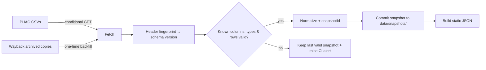

# Plague Doctor — Kiroween 2026 Build Plan

**Version:** 2.2 — 31 October 2026 (project-lead amendments to reviewed v2.1)
**Status:** Final plan. Approved for Milestone 1 (data ingestion). Hi-fi UI design: see §5A and `kiroween/design/`. Later features gated by verified sources and tests.
**Category:** Costume Contest
**Deadline:** **Friday 4 December 2026, 2:00 PM PT / 5:00 PM Toronto** — internal target: submit **Thursday 3 December**
**Tagline:** *Understand what's circulating before you gather.*

> **Product boundary.** Plague Doctor is an educational public-health surveillance and event-planning app. It does not diagnose illness, judge whether a gathering is safe, estimate anyone's infection probability, or forecast disease. Every displayed virus measurement traces to a named source file, location, virus and sampling week.

---

## Project-lead amendments in v2.2

| # | Amendment | Why |
|---|---|---|
| L1 | **Contradictions fixed:** schema-drift scenario now accepts reordered known headers (matches §6); property count is 11 everywhere; `POST /api/event-summary` removed (event summary is client-only, per privacy rule); replay is "never cut **if captures exist**", consistent with the Nov 8 gate. | v2.1 stated each rule two different ways. |
| L2 | **NA codes now use PHAC's own definitions** (verified on the dashboard page 2026-10-31): **NA1** = newly onboarded site, < 12 months of data, awaiting baseline. **NA2** = site stopped sampling, has no recent data, or is not being sampled. The v2.1 wording "fewer than 3 samples in 5 weeks" was not found on PHAC's page and is removed. | Accuracy of user-facing copy. |
| L3 | **Aggregate-coverage rule added:** PHAC reports city/province aggregates only when data covers ≥ 50% of the population (≥ 75% nationally). A missing aggregate row is a coverage gap, not "not detected". | PHAC technical notes. |
| L4 | **§5A UI design spec added** (tokens, type, components, screens, states, motion) + hi-fi prototype in `kiroween/design/`. Design is now a gate *before* UI build (Nov 16), not improvised during it. | Design = 20% of score; Costume Contest is judged on it. |
| L5 | **Asset licensing:** plague-doctor guide is drawn from the public-domain 1656 engraving *"Doctor Schnabel von Rom"* (Paul Fürst) or original artwork; fonts are SIL OFL (Google Fonts); demo video uses no music or a royalty-free track with licence saved in repo. No AI-generated imagery of real people. | Rules require permitted assets only. |
| L6 | **Map coordinates source fixed:** boundaries = Statistics Canada cartographic boundary files (OGL-Canada); city points = Natural Earth populated places (public domain) with a hand-checked override table for PHAC location names. | v2.1 said "a licensed gazetteer" without naming one. |
| L7 | **Performance budget:** never ship the 63k-row history to the browser. Build step emits one JSON per location × virus (≈ few KB each) + a small index. Target: landing page ≤ 200 KB JS gzip, LCP < 2.5 s on mid-range mobile. | Judges open the URL on phones. |
| L8 | **Date rule:** all "age" maths uses calendar dates in `America/Toronto`; `weekStart` is an EpiWeek Sunday, so displayed copy says "week of {date}", never "sampled on {date}". | Avoids off-by-one and false precision. |
| L9 | **Every screen needs four states designed:** loading, empty/no data, error/stale, success. Listed per screen in §5A. | Most hackathon apps break on non-happy paths; ours is *about* them. |
| L10 | **Devpost write-up skeleton + bonus deliverables** added to §12 so they are not written at 1 a.m. on Dec 3. | Presentation = 20%. |

## Review amendments in v2.1

- **Historical band:** `min`/`max` is the observed historical minimum/maximum, **not** a typical, expected or probabilistic range. It cannot forecast a future event.
- **Privacy:** Event attendee categories and preferences are processed and stored locally only. Server API requests must not receive attendee flags or free text.
- **Living card baseline:** Local saved events retain their original `snapshotId`, captured factual observations and creation time, allowing a true before/after diff.
- **Parser:** Reordering known CSV column headers is accepted, while unknown or incompatible field names/types fail closed.
- **Replay:** A Wayback capture date is not a clinical sample date; playback only shows verified archived values actually present in each captured file. Missing weeks stay blank.
- **Build order:** Data ingestion and a truthful provenance read path must pass before spending time on Wayback backfill, MCP, fog design or replay.
- **Coverage:** Never hardcode a city's availability, or discontinued-site status, from an October 2026 snapshot; recompute with each valid source update.

## 0. What changed from v1.0 (and why)

The original author reports the following observations from PHAC files retrieved on 2026-10-31. The new ingestion pipeline must independently validate the current source bytes, schemas and values before using them.

| # | Change | Evidence |
|---|---|---|
| 1 | **Historical weeks have no official activity level.** The timeline shows the measured concentration (`w_avg`) + PHAC's observed historical minimum/maximum band; official activity levels appear only for weeks where we hold a PHAC trend snapshot. | `wastewater_aggregate.csv` has `w_avg, min, max` per week but **no level/trend columns**. Only `wastewater_trend.csv` has levels — and only for the **latest** week. |
| 2 | **PHAC publishes two different classifications — pick one per UI element.** Headline = `Viral_Activity_Level` (PHAC's "activity level index", level + trend). Secondary = `latestLevel` ("signal level"). Never mix. | Toronto COVID, week of 2025-11-30: `latestLevel = Moderate`, `Viral_Activity_Level = High`. |
| 3 | **Schema drift is real → header-driven, versioned parser.** | Dec 2025 trend file had `t_low, t_high`; the Oct 2026 file has `min, max` in the same positions. A positional parser would silently mislabel data. |
| 4 | **Start archiving PHAC snapshots now + backfill from the Wayback Machine.** This is what makes the card genuinely "living" and gives an honest replay with *official* levels. | Wayback holds ≥15 archived `wastewater_trend.csv` copies incl. **2025-11-12** and **2025-12-20** (Dec copy verified: real Toronto/Halifax levels for week of 2025-11-30). |
| 5 | **Allow PHAC's own provincial aggregate (labelled) for uncovered cities; still never a neighbouring city.** | Trend file contains `grouping = Province` rows for 11 provinces/territories (PHAC-published, not our inference). Ottawa has no site → "Ontario (provincial aggregate, PHAC)". |
| 6 | **Freshness thresholds re-calibrated to PHAC's real lag.** Reviewer's "0–14 days = recent" would mark most data amber most of the time. | On 2026-10-31: Toronto latest sample 13 days old; Alberta/Quebec/Saskatchewan 20 days old — normal publication lag, not a fault. |
| 7 | **NA codes handled explicitly.** `NA1`/`NA2` → `unknown` with a reason code; NA1 can coexist with a valid `latestLevel`. | Fredericton fluA: `latestLevel = Moderate`, `Viral_Activity_Level = NA1`. PHAC needs ≥12 months of data to compute the index (technical notes). |
| 8 | **Drop Postgres + Prisma for MVP.** Git-versioned snapshots + static normalized JSON give immutable provenance with zero infrastructure. | ~63k history rows + ~335 trend rows per snapshot. |
| 9 | **Add missing logistics:** Kiro credits request (deadline Tue Dec 1 noon PT), bonus blog/social post, earlier video recording. | Not in v1.0. |
| 10 | **Demo gets its wow moment back:** a watermarked replay of last holiday season using archived **official** PHAC levels. | Enabled by #4. |

---

## 1. Executive decision

Build a beautiful, interactive Canadian respiratory-virus activity explorer with an event-specific planning experience. The distinction is not the map: it is a **living gathering card** that states what dated community wastewater observations can and cannot say, shows what changed since the last PHAC update, and produces a source-linked summary to share.

**One-sentence demo:** *"I'm planning a family dinner in Toronto next weekend. Show me what the latest wastewater samples can and cannot tell me, then make a planning card I can share."*

**Credibility pillars**
- **Real evidence** — PHAC National Wastewater Monitoring data + methodology.
- **Interactive evidence** — place, virus, week and event all change the view, text and card.
- **Honest uncertainty** — delayed, missing, discontinued or insufficient data → explained *Unknown / No recent data*, never an invented value.
- **Distinctive design** — fog, lantern and guide encode activity and evidence quality.
- **Kiro proof** — real specs, steering, hooks, property tests, MCP, all in the public repo.

**Definition of success:** a first-time visitor completes *select city → inspect trend → plan event → get evidence-linked card → share* without an account in under 90 seconds — **measured** with ≥3 test users, not assumed. After returning, a locally saved event must visibly identify its baseline snapshot and explain factual changes compared with a newer snapshot, or say that nothing has changed.

---

## 2. Users, needs and non-goals

**Audiences:** (1) families/event planners, (2) travellers, (3) public-health communicators.

**Jobs to be done**
- "Tell me whether recent surveillance exists for this city, and how old it is."
- "Show whether a virus' wastewater signal is increasing, stable or decreasing."
- "Help me consider general prevention steps for an indoor gathering."
- "Give me a clean summary I can send without exaggerating."

**Non-goals (hackathon):** diagnosis, symptom checking, triage, individual risk scores, treatment advice, outbreak prediction · "safe/unsafe" verdicts · hospital/patient data · claims of full Canadian coverage · clinic availability scraping · native app, accounts, SMS, forecasting models · unreviewed generative-AI medical text or fabricated citations.

---

## 3. Feature priorities

| ID | Feature | Pri | Done when… |
|---|---|---|---|
| F01 | Haunted Canada map + accessible city list | P0 | Live / provincial-aggregate-only / stale / discontinued states distinguishable; list works without map |
| F02 | Four-virus filter | P0 | Map, list, legend, drawer and card update atomically |
| F03 | City detail drawer | P0 | Activity index, signal level, trend, sample week, source, limitations; city aggregate first, sites on drill-down |
| F04 | Historic timeline | P0 | Plots measured `w_avg` with PHAC min/max band; official levels **only** on snapshot weeks; gaps stay gaps; never extends into the future |
| F05 | Guided Gathering Planner | P0 | City, date, setting, optional broad audience → card with observations or explicit unknown |
| F06 | "Why does it say this?" | P0 | Every statement links to snapshot ID, row, field and rule |
| F07 | Omen Card text share | P0 | Includes data age, location/period, no-forecast caveat; no attendee info |
| F08 | Ingestion, snapshots, provenance | P0 | Scheduled, header-validated, idempotent, never overwrites good data |
| F09 | Accessible haunted visual system | P0 | Keyboard, mobile, reduced motion, no colour-only signals |
| F10 | **"What changed since last update"** on saved cards | P0 | Local event saves baseline snapshot ID + immutable factual card contents + created time; re-opening compares with current snapshot and distinguishes changed values, revisions, missing data and unchanged status |
| F11 | **Holiday-season replay** (archived PHAC snapshots) | P0, dependent on capture availability | Steps only through verified Wayback captures; each capture displays its capture date and underlying sample week; missing capture periods remain gaps; do not invent official indices |
| F12 | PNG card export | P1 | Matches text share exactly, caveats included |
| F13 | Free-text event parsing (LLM) | P1 | Parsed fields shown for confirmation; cannot emit virus data |
| F14 | City comparison | P2 | Activity index only; no raw-concentration ranking |
| F15 | Update notifications | P2 | Only with a privacy-safe channel |
| F16 | French UI | P2 | Reviewed translation only |

**Scope lock:** all P0 before any P1/P2. Cut order if behind: animations → PNG → LLM parsing. **Never cut:** provenance, data-quality states, snapshot diff, and replay *if verified captures exist* (otherwise replay is deferred per the Nov 8 gate, and the demo uses our own weekly snapshots instead).

---

## 4. Screens and interactions

### A — Landing: "What's in the water?"
Promise + limitation line → map (desktop) / searchable list (mobile) → virus chips → legend → freshness footer showing **three clocks** (sample week · PHAC file `Last-Modified` · our last successful ingest).
- Hover/focus city: name, coverage state, latest sample week, activity index.
- Toggle "show discontinued sites" (Calgary, Vancouver, Victoria, Winnipeg, Halifax, Sudbury, Toronto sites were discontinued 2025-09-05 per PHAC).
- Fog density = `Viral_Activity_Level` for one selected virus. Unknown = hatched, never "no fog".

### B — The Omen Timeline
- Line = measured weekly `w_avg` (units per PHAC technical notes); shaded band = observed historical **minimum and maximum** for that EpiWeek since surveillance began, **not** a typical or predictive range.
- Lantern markers on weeks where we hold an official PHAC snapshot → show that week's official activity index and trend.
- Gaps visible; no smoothing; no projection. Future event date shown as a separate marker with no values.
- Tooltips never translate concentration into "people infected".

### C — Gathering Planner
Where → When → Setting → Who (optional broad categories: older adults, infants, immunocompromised; never names/ages/diagnoses) → Confirm.

**Timing rules**
| Event date | Card behaviour |
|---|---|
| > 21 days ahead | "Too early to know activity on that date." Historical context, if shown, consists solely of PHAC observed historical min/max for the matching EpiWeek, labelled *past observations, not a prediction* + general prevention checklist. |
| 0–21 days ahead | Latest observed activity + age, labelled "as of week of {date}, not on your event date". |
| Past | Historical observations for that period; gaps labelled. |
| No city coverage | Missing-data state + **optional** PHAC provincial aggregate, labelled as such. Never a neighbouring city. |

### D — Living Event Card
Header (place, date, setting, created) · four viruses (activity index, trend, sample week, age) · "community wastewater, not your chance of getting sick" · prevention checklist from PHAC guidance with review date · evidence links · actions: edit, sources, save locally, **see what changed**, copy share text, PNG (P1). On opt-in local save, persist the original snapshot ID and factual summary to establish a comparison baseline; when a new snapshot arrives, display field-level changes with both observation dates.

Shared text is a **dated snapshot**, never called "live". Only the creator's locally saved card recomputes. No attendee categories, medical preferences, or free text may appear in shared content or URLs.

### E — "Behind the Mask" (methods)
Source links · three clocks · classification provenance (`publisher` vs `derived`) · coverage and discontinued sites · schema version used · what wastewater cannot establish.

---

## 5. Design system

> Full hi-fi spec in **§5A**. This table is the non-negotiable rule set.

Scientific gothic: ink navy, amber lantern, teal fog, parchment panels; no gore, no "plague is coming".

| Element | Rule |
|---|---|
| Fog | Always paired with text label + legend |
| Lantern | Brightness = data freshness, **never** activity |
| Guide | Short explanations; never impersonates a clinician |
| Colour | Always + icon + word + pattern |
| Timeline | No future values |
| Omen Card | Data age + limitation visible on every export |

**Accessibility:** WCAG 2.2 AA target, keyboard nav, screen-reader chart summaries, reduced-motion (static fog), ~44 px touch targets.

**User testing (Week 4, ≥3 people, ~20 min each):** find latest Flu A for a city · say when it was sampled · find a no-data place and explain it · plan an event 4 weeks out and say what the app concludes · share a card keeping attendees private. Revise if anyone reads "low activity" as "no risk".

---

## 5A. UI design specification (hi-fi)

Prototype: Design canvas https://claude.ai/artifact/Bj1USSBWEHandEhEiCBGFk (6 artboards: landing+drawer, planner, Omen Card, honesty states, mobile, tokens; real PHAC values) — source copies in `kiroween/design/*.dc.html`. Treat it as the Figma-equivalent source of truth; changes go there first.

### Tokens
| Token | Value | Use |
|---|---|---|
| `--ink-900` | `#0B1020` | page background |
| `--ink-800` | `#121A30` | panels |
| `--ink-700` | `#1C2742` | raised cards, inputs |
| `--parchment` | `#EADFC8` | primary text on dark; Omen Card paper |
| `--parchment-dim` | `#B9AE98` | secondary text |
| `--lantern` | `#F2B544` | focus, primary action, *freshness* only |
| `--fog-teal` | `#5FD3BC` | fog base hue (density varies, hue does not) |
| `--level-high` | `#E0664F` + ▲▲ icon + "High" | activity index High |
| `--level-moderate` | `#E9A84A` + ▲ icon + "Moderate" | |
| `--level-low` | `#7FB7A4` + ▽ icon + "Low" | |
| `--level-nd` | `#8C93A8` + ○ icon + "Not detected" | |
| `--level-unknown` | hatched `#5A6178` + ? icon + "No data" | NA / missing / stale |
| `--replay` | `#B79CFF` | replay watermark + frame only |

Level colours are never used alone: always icon + word (+ hatch for unknown). All text pairs meet ≥ 4.5:1 on `--ink-900`.

### Type
- Display: **Cormorant Garamond** 600 (OFL) — headings, card titles, guide quotes.
- UI/body: **Inter** 400/500/600 (OFL) — everything functional.
- Data: **JetBrains Mono** 500 (OFL) — dates, snapshot IDs, numbers.
- Scale: 12 / 14 / 16 / 20 / 28 / 40 px; line-height 1.5 body, 1.15 display.

### Layout
- Desktop ≥ 1024: map 2/3 + right drawer 1/3 (400 px). Tablet: map full, drawer as bottom sheet. Mobile < 640: **list-first**, map collapsed behind a "Show map" toggle; 16 px gutters; no horizontal scroll.
- Spacing: 4-px base; 8 / 12 / 16 / 24 / 32 / 48.
- Radius: 6 (inputs), 12 (cards), 20 (Omen Card).

### Components
`VirusChip` (4, single-select, keyboard arrows) · `LevelBadge` (icon + word + colour/hatch) · `TrendGlyph` (↗ increasing / → stable / ↘ decreasing / ? unknown) · `FreshnessLantern` (bright ≤21 d, dim 22–35 d, out >35 d — with text) · `ThreeClocks` (sample week · PHAC file updated · our ingest) · `CityRow` · `CityDrawer` · `TimelineChart` (line + min/max band + lantern markers + gaps + future marker) · `PlannerStepper` (5 steps) · `OmenCard` · `ChangeDiff` · `ReplayFrame` · `GuideQuote` (plague-doctor avatar + one-sentence explanation) · `SourceFootnote`.

### Screens × states
| Screen | Loading | Empty / no data | Error / stale | Success |
|---|---|---|---|---|
| A Landing/map | skeleton list + static fog | "No locations in this snapshot" | banner "Showing last verified data from week of {date}" | map + list + chips |
| B City drawer/timeline | chart skeleton | "No monitoring site for {city}" + PHAC province aggregate option | Outdated lantern + history only | badges, trend, chart |
| C Planner | — | city with no coverage → explained, still continues to checklist | date in past/too far → explained rule | 5-step stepper |
| D Omen Card | card shimmer | "No recent data — here's the general checklist" | snapshot unavailable → baseline-only card | four virus rows + caveat + share |
| E Behind the Mask | — | — | ingestion failure details | sources, clocks, schema version |

### Motion
Fog: slow (12–20 s) drift loop, density eases over 600 ms on virus change. Card state changes: 200 ms fade/slide. `prefers-reduced-motion`: static fog texture, no drift, instant transitions.

### Voice (guide copy examples)
- ✅ "Flu A in Toronto's wastewater was **Moderate** in the week of Oct 18, and stable."
- ✅ "It's too early to know what will be circulating on Dec 21. Here's what past years looked like — not a prediction."
- ❌ "Toronto is safe for your dinner." ❌ "Flu will peak at Christmas."

## 6. Data and scientific requirements

### Sources (all returned HTTP 200 on 2026-10-31)
- Dashboard: https://health-infobase.canada.ca/wastewater/
- History CSV: https://health-infobase.canada.ca/src/data/wastewater/wastewater_aggregate.csv
- Trend CSV: https://health-infobase.canada.ca/src/data/wastewater/wastewater_trend.csv (supports `ETag` + `Last-Modified` → conditional GET)
- Dictionary: https://health-infobase.canada.ca/src/data/covidLive/wastewater/covid19-wastewater-data-dictionary-en.csv
- Technical notes: https://health-infobase.canada.ca/wastewater/technical-notes.html
- Protective measures: https://www.canada.ca/en/public-health/services/diseases/respiratory-infectious-diseases-reduce-spread-personal-protective-measures.html
- Archive backfill: Wayback Machine CDX for `wastewater_trend.csv`
- **TODO W0:** confirm dataset-specific reuse terms and attribution requirements; the federal Open Government Licence is available at https://open.canada.ca/en/open-government-licence-canada, but applicability to each asset must be verified.

### Verified file facts
| File | Columns (Oct 2026) | Notes |
|---|---|---|
| trend | `Location, measureid, latestTrend, pruid, min, max, latestLevel, grouping, city, province, country, Viral_Activity_Level, weekStart` | Latest week only. `grouping ∈ Site, City, Province, Canada`. Dec 2025 version had `t_low, t_high` instead of `min, max`. |
| aggregate | `Location, site, city, province, country, EpiYear, EpiWeek, weekstart, measureid, w_avg, min, max, populationcoverage, pruid` | History since 2022. No level/trend. |

Values: `measureid ∈ covN2, fluA, fluB, rsv` · `Viral_Activity_Level ∈ Non-detect, Low, Moderate, High, NA1, NA2` · `latestTrend ∈ Increasing, Decreasing, No Change, No Recent Data`.

### Interpretation guardrails
1. Use PHAC's classifications verbatim; headline = `Viral_Activity_Level`.
2. Trends use PHAC's 5-week method; we do not compute our own trend in MVP.
3. Non-detect ≠ no disease; missing ≠ zero.
4. Concentration ≠ cases, hospitalizations or individual risk.
5. No cross-city ranking by raw concentration.
6. Revisions happen: snapshots are immutable; outputs cite the snapshot used.
7. Data age always visible; freshness labels are **our UX convention**, not PHAC's. The date is an epidemiological week start, not the actual day of sample collection.
8. Historical min/max values are extremes across recorded observations, not typical levels, confidence intervals or a forecast for a future gathering.
9. A province aggregate is a regional observation, not a substitute estimate for an uncovered city.

### Freshness convention (configurable, property-tested)
| Sample week start age | Label | Behaviour |
|---|---|---|
| ≤ 21 days | **Latest available** | Normal display with date (never "real-time") |
| 22–35 days | **Delayed** | Amber caution |
| > 35 days or `No Recent Data` | **Outdated** | History only; no "current activity" claims |
| No valid observation / NA | **No data / insufficient** | Never green, zero or "safe" |

Calculated from sample week, never from download time. Review thresholds after 3 weekly snapshots.

### Normalized types
```ts
type Pathogen = "covid19" | "fluA" | "fluB" | "rsv";
type Activity = "high" | "moderate" | "low" | "not_detected" | "unknown";
type UnknownReason =
  | "na1_new_site"            // PHAC NA1: < 12 months of data, awaiting baseline
  | "na2_not_sampling"        // PHAC NA2: stopped sampling / no recent data / not sampled
  | "no_recent_data"          // latestTrend = No Recent Data
  | "aggregate_below_coverage"// no aggregate row: < 50% pop (< 75% national)
  | "missing_row" | "parse_error";
type Direction = "increasing" | "stable" | "decreasing" | "unknown";

type StatusObservation = {          // from a trend snapshot
  snapshotId: string;               // sha256 of source file
  locationId: string;
  grouping: "site" | "city" | "province" | "national";
  pathogen: Pathogen;
  weekStart: string;                // ISO date
  activityIndex: Activity;          // Viral_Activity_Level
  signalLevel: Activity;            // latestLevel
  trend: Direction;                 // latestTrend
  unknownReason?: UnknownReason;
  interpretationMethod: "publisher";
};

type MeasuredWeek = {               // from the aggregate file
  snapshotId: string;
  locationId: string;
  pathogen: Pathogen;
  epiYear: number; epiWeek: number; weekStart: string;
  wAvg: number | null;
  histMin: number | null; histMax: number | null;
  populationCoverage: number | null;
};

type SourceSnapshot = {
  snapshotId: string; sourceUrl: string;
  fetchedAt: string; lastModified?: string; etag?: string;
  origin: "live" | "wayback";       // archived copies clearly marked
  archivedAt?: string;              // Wayback timestamp
  schemaVersion: string;            // header fingerprint
  rowCount: number; rejectedRows: number;
  status: "valid" | "rejected";
};
```

### Ingestion

- **GitHub Actions cron**, daily (catches revisions; PHAC updates Wednesdays ~noon ET). Unchanged ETag → no-op.
- Header-driven mapping per schema version; allow reordered known columns because values are accessed by header name. Unknown/incompatible required columns or formats → reject (fail closed). Extra unexpected columns require explicit compatibility review.
- Zod row validation; log rejected-row counts.
- Git history = immutable provenance; no database.
- Never fetch CSVs from the browser.

---

## 7. Architecture

| Layer | Choice |
|---|---|
| App | Next.js App Router + TypeScript |
| UI | Tailwind + shadcn/ui |
| Map | SVG via d3-geo; StatCan cartographic boundaries (OGL-Canada, simplified with mapshaper); city points from Natural Earth populated places (public domain) + override table for PHAC names |
| Charts | Visx or Recharts (gap support required) |
| Data | Git-versioned snapshots → static JSON at build; read-only route handlers |
| Validation | Zod |
| Tests | Vitest + fast-check; Playwright + axe smoke |
| Jobs | GitHub Actions cron |
| Hosting | **Open:** Vercel (simplest) vs AWS Amplify (sponsor) |

**Routes:** `GET /api/locations` · `GET /api/observations?locationId&pathogen&from&to` · `GET /api/status?locationId` · `GET /api/data-status` · `GET /api/snapshots` · `POST /api/parse-event` (P1 only; receives free text the user explicitly submits, returns draft fields; never logged). The event card is computed client-side.

**Security/privacy:** strict validation, no user-supplied URL fetching, no secrets client-side, rate-limit optional LLM endpoint. Attendee categories stay on the client: do not send them to `/api/event-summary`, URL parameters, logging, analytics, or export routes. Build the event summary in pure client-side code using read-only public observations; there is no event-summary endpoint. Locally saved events use explicit opt-in and offer deletion; browsers or device backups may still retain locally stored details.

---

## 8. Safety and correctness

**Banned output:** "safe to attend", "you will get sick", "X% chance", "flu will be high on {date}", promoting no-data → low, low → no risk, non-detect → no infections; implying PHAC endorsement; mixing replay/fixture data with live data without watermark.

**Acceptance scenarios**
```gherkin
Scenario: Event beyond what wastewater can say
  Given an event 6 weeks from today
  Then the card states future activity is unknown
  And shows only labelled historical context and the prevention checklist

Scenario: Stale location
  Given the latest valid sample week is more than 35 days old
  Then the city shows "Outdated" with its original sample week
  And no current-activity claim is made

Scenario: Known columns reordered
  Given PHAC reorders known trend columns
  When ingestion runs
  Then the snapshot is accepted and normalized values are identical

Scenario: Schema drift
  Given PHAC renames, removes or retypes a required trend column
  When ingestion runs
  Then the snapshot is rejected, the last valid snapshot is served, and CI alerts

Scenario: Aggregate below coverage threshold
  Given a city has site rows but no city aggregate row
  Then the city shows "aggregate not published (coverage below PHAC threshold)"
  And never shows "not detected"

Scenario: Uncovered city
  Given the user picks Ottawa
  Then the card says there is no Ottawa monitoring site
  And offers "Ontario (provincial aggregate, PHAC)" clearly labelled
  And never shows another city's values

Scenario: Share
  Given optional attendee categories
  When the user copies the share text
  Then it includes source and sample week and excludes attendee categories
```

**Property-based tests (fast-check)**
1. Changing only `fetchedAt`/ingest time never makes an old sample "Latest available".
2. Missing/NA rows never yield `low` or `not_detected`.
3. Events beyond the latest observation never contain measured-condition claims for that date.
4. Re-ingesting the same file is idempotent (same `snapshotId`, no duplicate rows).
5. Every returned record matches the requested pathogen and grouping.
6. Card `activityIndex` always equals the source `Viral_Activity_Level` (no re-classification).
7. Permutations of known header columns are accepted and produce identical normalized values; incompatible or unregistered column renames are rejected.
8. Share text never contains attendee categories or free text.
9. Replay output always carries the archive watermark, Wayback capture date, underlying PHAC sample week and source snapshot ID; unavailable periods remain gaps.
10. A saved event comparison uses its stored baseline snapshot and never treats missing or revised fields as a measured increase/decrease without evidence.
11. Sensitive attendee categories do not cross a network boundary or appear in any export, analytics or server logs.

---

## 9. Kiro usage

> Kiro steering and hooks govern **development**. Runtime safety lives in code + tests.

```
.kiro/
├─ steering/
│  ├─ product-principles.md      # boundary, non-goals, privacy
│  ├─ scientific-integrity.md    # PHAC verbatim, two classifications, freshness, no forecasts
│  ├─ wording-safety.md          # banned phrases, required caveats
│  ├─ architecture.md            # snapshots, schema registry, pure evidence engine
│  ├─ design-language.md         # gothic system, a11y rules, lantern ≠ activity
│  └─ coding-and-testing.md
├─ specs/
│  ├─ data-ingestion/            # requirements.md, design.md, tasks.md
│  ├─ evidence-engine/
│  ├─ interactive-surveillance-ui/
│  ├─ event-planner/
│  └─ replay-and-snapshots/
└─ hooks/                        # created via Kiro UI
```

| Kiro feature | Concrete use |
|---|---|
| Specs | 5 specs with requirement IDs; code/commits reference IDs |
| Steering | 6 docs above |
| Hooks | (a) save in `src/evidence/**` → Vitest + properties; (b) change in ingestion/schema → fixture validation incl. Dec-2025 and Oct-2026 header variants; (c) save in copy/components → banned-phrase linter; (d) manual → append to `docs/KIRO_USAGE.md` |
| PBT | 11 properties above; **record at least one real bug a property caught** for the write-up |
| MCP | Read-only local server: `list_snapshots`, `get_schema`, `sample_rows`, `get_status` — dev-time only |
| Evidence | `.kiro/` committed from day 1; `docs/KIRO_USAGE.md` log feeds README + blog |

---

## 10. Schedule (5 weeks)

| Dates | Focus | Exit gate |
|---|---|---|
| **Sat Oct 31 – Sun Nov 1** | Request **Kiro credits** · create fresh public repo (MIT) · steering v1 · establish exact source URLs and licence · ingest current PHAC CSVs | First live snapshot parsed with header-by-name validation, provenance and sample-week dates; do not block on Wayback availability |
| Nov 2 – 8 | Complete ingestion spec + implementation, schema registry, API read path; then attempt Wayback backfill and dev-time MCP | Idempotent; known header permutation accepted; schema drift rejected; one real record queryable with provenance; optional ≥2 captured archived snapshots |
| Nov 9 – 15 | Evidence engine + all properties; freshness + coverage logic | 11 properties green; Ottawa/Halifax/Toronto edge cases correct |
| Nov 9 – 15 (parallel, evenings) | Finalize hi-fi design from `kiroween/design/` prototype; export tokens to `tailwind.config` | **Design gate:** all 5 screens × 4 states approved before UI code |
| Nov 16 – 22 | Map, list, virus filter, drawer, timeline | All four viruses; gaps; discontinued toggle; matches design tokens |
| Nov 23 – 29 | Planner, living card, snapshot diff, replay, share text | End-to-end no-login journey; replay watermarked |
| **Mon Nov 30 – Tue Dec 1** | User tests, a11y, polish, deploy · **redeem credits before Dec 1 noon PT** | Public URL; tests pass; **first full demo recorded Dec 1** |
| Wed Dec 2 | Video edit, README, Kiro write-up, blog draft | Devpost draft complete |
| **Thu Dec 3** | Final audit, social post `#KiroweenHackathon26`, **submit** | Submitted |
| Fri Dec 4 | Buffer only (deadline 2 PM PT) | — |

**Gate after Nov 8:** if live import is unreliable, pivot to a clearly labelled **verified historical explorer** built from archival copies only if they have been validated. If Wayback backfill is unavailable, do not fabricate replay; preserve a functional live explorer and defer replay until sufficient real weekly snapshots exist. Never disguise mock data as PHAC data.

---

## 11. Three-minute demo

| Time | Beat | Takeaway |
|---|---|---|
| 0:00–0:15 | Holiday dinner coming; PHAC dashboards are hard to read | Problem |
| 0:15–0:40 | Fog rises over Canada; pick Toronto; three clocks visible | Real data, distinctive UX |
| 0:40–1:00 | Flu A timeline: measured line, historical band, lantern = official snapshot weeks | Interactivity + integrity |
| 1:00–1:25 | Plan "Dinner, Toronto, next Saturday" → Omen Card | Practical value |
| 1:25–1:45 | Plan Christmas 7 weeks out → **"Too early to know."** | Memorable honesty |
| 1:45–2:05 | **Replay** last holiday season (archived official PHAC levels, watermarked): card moves through real weeks, "what changed" diff | Living card, no fake forecast |
| 2:05–2:15 | Ottawa → no site → labelled Ontario aggregate | Trust |
| 2:15–2:40 | Kiro: specs, steering, hook running property tests, the bug a property caught | Effective Kiro |
| 2:40–2:55 | "Make plans with evidence, not false certainty." | Close |

---

## 12. Ship checklist

**Product** — community vs personal risk understood by testers · city availability derived from live snapshot (not historical rows) · city list works without map · every interaction changes data · card useful even with no data · no stale state shown while loading.

**Science & safety** — every value has source, place, virus, sample week · historical / unknown / current / replay visually distinct · no forecast, probability or diagnosis · prevention copy sourced + dated · no case/hospitalization claims · schema drift + discontinued sites handled.

**Engineering** — idempotent fail-safe ingestion · drift tests on both known schemas · properties + Playwright pass · no secrets or attendee data in client/logs · mobile + a11y + reduced motion tested · live URL needs no login.

**Submission** — repo created after Oct 30 9am PT · Costume Contest selected · `.kiro/` committed · MIT licence visible · working URL · public YouTube < 3 min, permitted assets only · write-up covers differentiation, limitations, Kiro usage · PHAC attribution without implied endorsement · bonus blog + social post · **submitted Dec 3**.

---

### Devpost write-up skeleton (draft by Dec 2)
1. **Inspiration** — Canadian families planning holiday visits; PHAC data exists but is hard to read.
2. **What it does** — map, timeline, Gathering Planner, living Omen Card, honest "too early".
3. **How we built it** — stack + data pipeline (snapshots, schema registry).
4. **How Kiro was used** — specs (with IDs), 6 steering docs, hooks, MCP, property tests + the real bug a property caught. Screenshots from `docs/KIRO_USAGE.md`.
5. **Challenges** — schema drift, NA codes, coverage gaps, designing honesty.
6. **Accomplishments** — refuses to invent data; accessible gothic design.
7. **What we learned** · 8. **What's next** (FR UI, notifications, more surveillance sources).
9. **Limitations & data attribution** — PHAC, OGL wording, no endorsement.

**Bonus deliverables:** blog post (dev.to/Medium) from `KIRO_USAGE.md` · social post beginning `#KiroweenHackathon26` with 20-s clip · GIF of fog + "too early" moment for README.

## 13. First Kiro prompt (Milestone 1)

> Build Milestone 1 of Plague Doctor, a Canadian wastewater respiratory-virus explorer for Kiroween 2026. Treat `docs/BUILD_PLAN.md` (v2.2) as product requirements; NA1/NA2 meanings and the aggregate-coverage rule are in §15. Use spec-driven development: create `.kiro/specs/data-ingestion/` (requirements, design, tasks) and the steering docs listed in §9. Stack: Next.js App Router, TypeScript, Zod, Vitest, fast-check. Implement only ingestion and the read path.
> 1. Fetch PHAC's trend and aggregate CSVs server-side with conditional GET (ETag/Last-Modified).
> 2. Read the actual headers and the data dictionary before mapping. Implement a **header-fingerprint schema registry**; include both the Dec-2025 trend schema (`t_low, t_high`) and the Oct-2026 schema (`min, max`). Unknown schemas fail closed.
> 3. Only after live ingestion passes, attempt a Wayback backfill script for captured `wastewater_trend.csv` copies; mark them `origin: "wayback"` with their actual capture timestamp. A capture timestamp is not the clinical sample date; unavailable archives are an explicit limitation, not a reason to invent data.
> 4. Store each valid file as an immutable snapshot under `data/snapshots/` keyed by sha256; build normalized JSON.
> 5. Map `Viral_Activity_Level` → `activityIndex`, `latestLevel` → `signalLevel`; NA1/NA2/No Recent Data → `unknown` with reason codes.
> 6. Expose `/api/locations`, `/api/observations`, `/api/status`, `/api/data-status`, `/api/snapshots`; every response carries snapshotId, sample week and source URL.
> 7. Property tests: stale samples, missing values, NA codes, duplicate imports, accepted header reorderings, incompatible renamed headers, date boundaries.
> Never invent readings, dates, levels or locations. Do not build UI yet. Document every assumption and which fields the files actually contain.

**Milestone 1 acceptance:** typecheck + tests pass; one current, verified PHAC snapshot ingested; endpoints return accurate current values with source, week and schema version; a historical backfill attempt is documented but not mandatory for Milestone 1. Never hardcode Toronto or Ottawa availability: verify both using current snapshot data and report coverage gaps accurately. Add archived snapshots in the replay milestone if available.

---

## 14. Open decisions
1. Hosting: Vercel or AWS Amplify?
2. LLM parsing (F13): keep as P1 or drop entirely?
3. Timing boundary: 21 days, or 14?
4. Repo: `~/Desktop/plague-doctor` → GitHub `Ikechukwu-attah/plague-doctor`?
5. Devpost title: "Plague Doctor" or "Plague Doctor — The Gathering Planner"?

## 15. Audit trail (verified 2026-10-31)
- PHAC trend file: `Last-Modified: Wed, 28 Oct 2026 16:49:48 GMT`; latest sample week 2026-10-18 (some provinces 2026-10-11).
- Discontinued sites (PHAC notice 2025-09-05): Calgary (2), Metro Vancouver (3), Victoria, Winnipeg (1), Halifax (2), Sudbury, Toronto (2). Halifax and Toronto still have live sites.
- Activity index requires ≥12 months of data; trend uses previous 5 weeks (technical notes).
- Wayback: ≥15 archived trend files 2024-08 → 2026-09; Dec 2025 copy parsed successfully.
- Kiroween rules: submission period Oct 30 – Dec 4 2026 2 PM PT; `.kiro/` required; video < 3 min; credits form by Dec 1 noon PT.
- NA codes (verified on dashboard page text, 2026-10-31): NA1 = newly onboarded site with < 12 months of data, awaiting baseline; NA2 = site stopped sampling, no recent data, or not being sampled.
- Aggregates published only at ≥ 50% population coverage (≥ 75% national); signal level uses 25th/75th percentiles of the past year (technical notes).
- Still verify: dataset-specific reuse licence/attribution wording; original CSV bytes in the ingestion pipeline.
